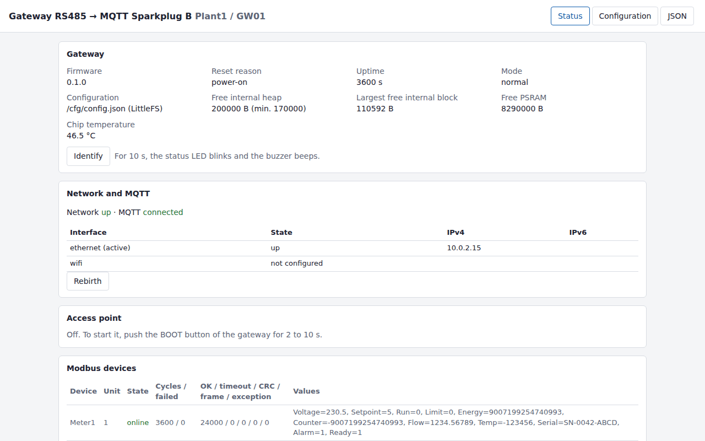
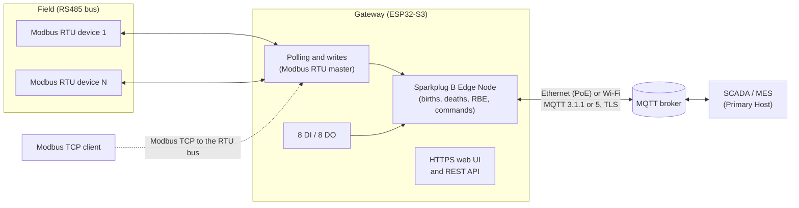
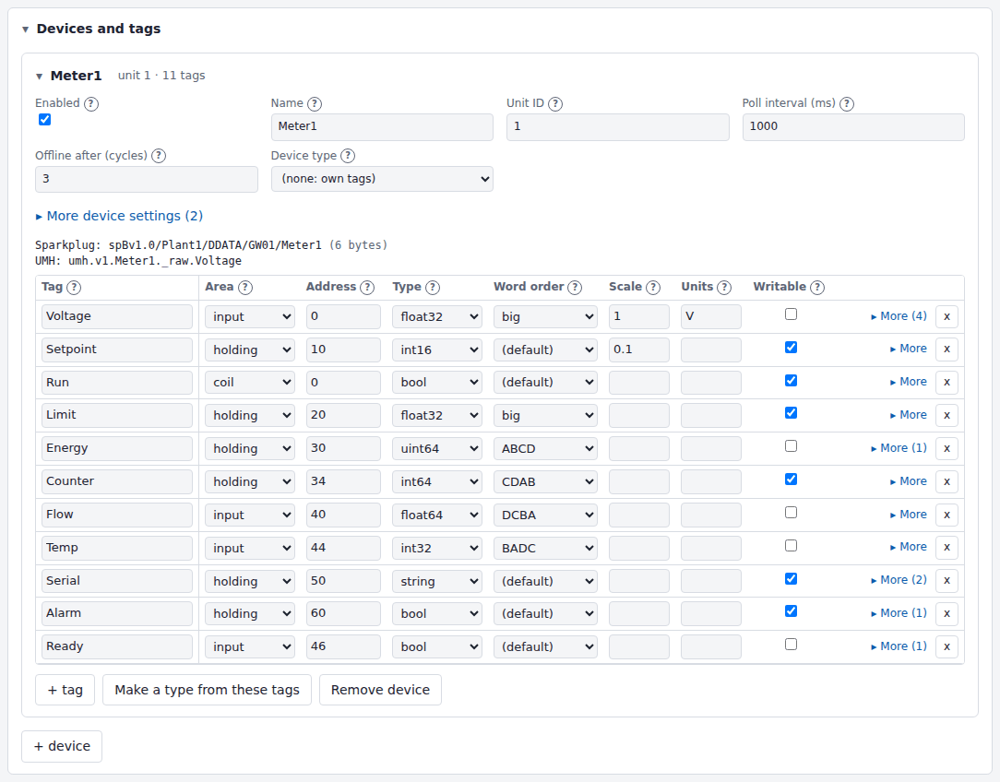
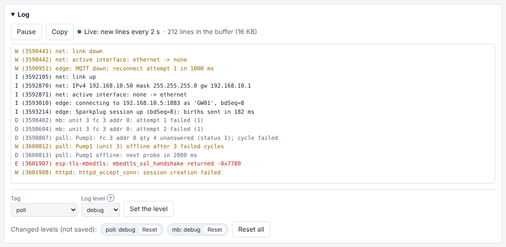

# mqtt-rs485-gateway

**Open-source firmware that connects Modbus RTU devices on an RS485 bus to MQTT, as a Sparkplug B 3.0 Edge Node.** It runs on the Waveshare ESP32-S3-POE-ETH-8DI-8DO board and uses ESP-IDF v6.1.

[](https://github.com/tmijail/mqtt-rs485-gateway/actions/workflows/ci.yml)


> [!WARNING]
> **Do not use this firmware in a plant. It is experimental, and it has never run on the board.**
>
> - No version is released. The project is before v1.0, and the formats of the stored data can change without a migration.
> - The firmware ran only in host tests and in QEMU (an emulated ESP32-S3), against a test broker and a simulated Modbus device.
> - The Ethernet chip (W5500), the RS485 hardware mode, the I/O expander of the outputs, the digital inputs, the status LED, the Wi-Fi, the microSD card and the real PSRAM are compile-only. Nobody has tested them (#1, #18).
> - Some board data comes from the vendor documentation and is not verified ([Board data to verify](docs/reference/board-data-to-verify.md)).
>
> For the status of each requirement, refer to [Requirements status](docs/reference/requirements-status.md) and [Known limitations](docs/reference/known-limitations.md).



*The web UI in QEMU. The images of the documentation come from the real firmware in the emulator.*

## Contents

- [What it does](#what-it-does)
- [Features](#features)
- [Hardware](#hardware)
- [Quick start](#quick-start)
- [Documentation](#documentation)
- [Development](#development)
- [Project principles](#project-principles)
- [License](#license)

## What it does

The gateway polls Modbus RTU devices on its RS485 port. It publishes their values to an MQTT broker with Sparkplug B 3.0.0. A SCADA or MES host (the Sparkplug *Primary Host*) reads the values and can write values back to the devices. The 8 digital inputs and the 8 digital outputs of the board are also Sparkplug metrics.

In Sparkplug, the gateway is an *Edge Node*, and each Modbus device is a Sparkplug *Device*.



## Features

**Modbus RTU master**

- Up to 16 devices, 64 tags for each device and 256 tags in total.
- Holding and input registers, coils and discrete inputs. The types are 16, 32 and 64-bit integers, float32, float64, strings, bytes and bits of a register, with all the word orders.
- Block reads, a fast and a slow scan, scale and offset, deadband, timeouts, retries and offline detection.
- Device types: write the tag list of a device model one time, and use it for many devices.
- A Modbus TCP server that forwards requests to the RTU bus (optional).

**Sparkplug B 3.0.0 Edge Node**

- Births and deaths of the node and of the devices, bdSeq, seq and aliases, report by exception, and rebirth.
- Writes from the host with NCMD and DCMD, with write limits for each tag.
- Properties and quality, node diagnostics, templates for device types, DataSet, Bytes and File.
- Primary Host awareness, and store & forward in RAM, with an optional spill to the microSD card.
- Tested against the Eclipse Sparkplug TCK (Edge Node profile) and against UMH Core. Refer to [Sparkplug TCK results](docs/reference/sparkplug-tck-results.md).

**Network and MQTT**

- Ethernet with PoE, and Wi-Fi as a backup or as the primary interface. IPv4 and IPv6.
- MQTT 3.1.1 or MQTT 5, TLS 1.2 or 1.3 with a client certificate, and a list of brokers with failover.
- A hostname and mDNS.
- UTC time from SNTP, from the RTC of the board or from the browser. The gateway opens no MQTT session without a valid clock, so the RTC battery is necessary.
- Remote syslog.

**Local I/O**

- 8 digital inputs with inversion, debounce, pulse counters, fast counters and run hours.
- 8 digital outputs with a safe state, pulse outputs and local rules.

**Configuration and maintenance**

- An HTTPS web UI controls all the keys of the configuration. A REST API and a serial shell are also available.
- A commissioning access point and a claim window: set the first web password on site with a phone.
- Firmware updates by HTTPS or by upload in the web UI, with a trial period and an automatic rollback.
- Safe mode, recovery mode, factory reset, a live log in the browser and core dumps.

## Hardware

| Item | Value |
|---|---|
| Board | Waveshare ESP32-S3-POE-ETH-8DI-8DO |
| Module | ESP32-S3-WROOM-1U-N16R8: 16 MB flash, 8 MB octal PSRAM |
| Network | W5500 Ethernet with PoE, Wi-Fi |
| Field bus | RS485 on UART1 |
| Local I/O | 8 digital inputs, 8 digital outputs on a TCA9554 expander |
| Other | PCF85063 RTC (fit the [RTC battery](docs/how-to/fit-the-rtc-battery.md)), microSD card, RGB LED, buzzer, BOOT button |

The isolated CAN port of the board is out of scope. For the pins and the data that are not verified, refer to [Board data to verify](docs/reference/board-data-to-verify.md).

## Quick start

> [!CAUTION]
> Use a board on the bench only, not in a plant. The firmware has never run on the board (see the warning at the top).

1. Install ESP-IDF v6.1 for the `esp32s3` target. Refer to [Build the firmware](docs/how-to/build-the-firmware.md).
2. Build and flash the firmware, and open the console:

   ```sh
   git clone https://github.com/tmijail/mqtt-rs485-gateway.git
   cd mqtt-rs485-gateway/idf
   idf.py set-target esp32s3 build
   idf.py -p <port> flash monitor
   ```

3. Find the address of the gateway and the commissioning password on the console.
4. Open `https://<address>/` in a browser, and configure the broker and the Modbus devices.

The tutorial [Your first gateway](docs/tutorials/first-gateway-on-the-bench.md) gives all the steps, from a new board to data on the broker.

## Documentation

The documentation is on the [documentation site](https://mijail.ar/mqtt-rs485-gateway/), and in [`docs/`](docs/README.md). It follows the Diátaxis structure: tutorials, how-to guides, reference and explanation.

| I want to … | Read |
|---|---|
| Learn the gateway on the bench | [Your first gateway](docs/tutorials/first-gateway-on-the-bench.md) |
| Connect the Modbus devices | [Connect the RS485 bus](docs/how-to/connect-the-rs485-bus.md), [Add a Modbus device](docs/how-to/add-a-modbus-device.md) |
| Configure the gateway | [Change, back up and restore the configuration](docs/how-to/change-the-configuration.md), [The configuration document](docs/reference/configuration.md) |
| Connect to a broker with TLS | [Connect to a broker with TLS](docs/how-to/connect-to-a-broker-with-tls.md) |
| Send the data to UMH Core | [Connect the gateway to UMH Core](docs/how-to/connect-to-umh-core.md) |
| Know the Sparkplug topics and metrics | [Sparkplug messages and metrics](docs/reference/sparkplug-messages-and-metrics.md) |
| Update the firmware | [Update the firmware](docs/how-to/update-the-firmware.md) |
| Repair a gateway | [Recover a gateway](docs/how-to/recover-the-gateway.md) |
| Know what works and what does not | [Requirements status](docs/reference/requirements-status.md), [Known limitations](docs/reference/known-limitations.md) |

All the guides are in the [documentation index](docs/README.md). The product specification is [`docs/SPEC.md`](docs/SPEC.md).

<table>
<tr>
<td></td>
<td></td>
</tr>
<tr>
<td align="center"><em>Devices and tags</em></td>
<td align="center"><em>The live log</em></td>
</tr>
</table>

## Development

The firmware is in [`idf/`](idf/). The testable logic is in the component `gw_core`, in pure C without ESP-IDF. The other components are thin adapters to ESP-IDF. Refer to [Architecture](docs/reference/architecture.md) and to [the reasons for the architecture](docs/explanation/architecture.md).

Run the host tests (no ESP-IDF necessary):

```sh
cmake -S idf/test/host -B build-host && cmake --build build-host -j && ctest --test-dir build-host --output-on-failure
```

The end-to-end (E2E) tests run the real firmware in QEMU, against mosquitto and a pymodbus slave. A change is complete only when the host tests and the full E2E of the two QEMU variants pass. Refer to:

- [Run the tests](docs/how-to/run-the-tests.md) and [Tests](docs/reference/tests.md);
- [Run the E2E tests in Docker](docs/how-to/run-e2e-in-docker.md) (also on Windows);
- [Build the firmware](docs/how-to/build-the-firmware.md) and [Build configuration](docs/reference/build-configuration.md);
- [Compiler warnings and stack data](docs/reference/compiler-warnings-and-stack.md).

The rules for contributors (code, tests, documentation in Simplified Technical English) are in [`CLAUDE.md`](CLAUDE.md). The open work is in the [GitHub issues](https://github.com/tmijail/mqtt-rs485-gateway/issues).

## Project principles

- **The owner keeps control of the board.** The firmware burns no eFuse and does not lock the board. The owner can always read, flash and change it. Refer to [Features that burn eFuses](docs/explanation/no-efuse-features.md).
- **Full Sparkplug conformance.** The gateway obeys each MUST and SHOULD of Sparkplug B 3.0.0 for an Edge Node. Where the specification permits a choice, [Sparkplug behavior](docs/reference/sparkplug-behavior.md) gives the choice and the reason.
- **The web UI configures everything.** Each key of the configuration has a control in the web UI.

## License

The project uses the [MIT License](LICENSE). The third-party components keep their own licenses, for example [nanopb](idf/components/nanopb/LICENSE.txt).
