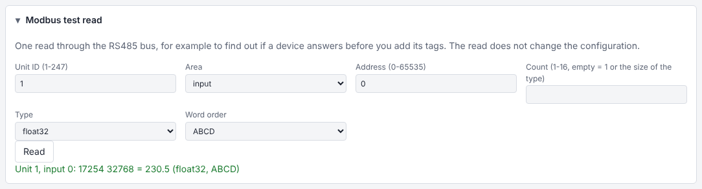

# Add a Modbus device and its tags

This procedure tells how to add a Modbus RTU device to the gateway in the web UI. The gateway then reads the tags of the device and publishes them in Sparkplug B.

- For the cable, the termination and the bias of the bus, refer to [Connect the RS485 bus](connect-the-rs485-bus.md).
- For all the keys of a device and of a tag, refer to [The configuration document](../reference/configuration.md#devices).
- For the names that UMH Core needs, refer to [UMH names and topics](../reference/umh-names-and-topics.md).

> **Warning: Do not use this document as verified data for the board.** The firmware has never run on the board (#1, #18). The RS485 hardware mode is compile-only. The images come from the firmware in QEMU, with a Modbus slave on the emulated UART.

## Before you start

You need:

- Access to the web UI of the gateway, with the web password.
- The device on the RS485 bus, with power.
- The data of the device: the unit ID (1 to 247), the baud rate, the parity and the stop bits.
- The register map of the device: for each value, the area, the address, the type and the word order.

All devices on one bus use the same baud rate, parity and stop bits. The RS485 settings of the gateway are the same for all devices.

## The areas and the types

| Area | Modbus function | Contents | Writable |
|---|---|---|---|
| `coil` | FC01 (write FC05, FC15) | One bit | Yes |
| `discrete` | FC02 | One bit | No |
| `holding` | FC03 (write FC06, FC16) | 16-bit registers | Yes |
| `input` | FC04 | 16-bit registers | No |

| Type | Registers | Note |
|---|---|---|
| `bool` | — | Only for `coil` and `discrete`. For one bit of a register, use `bool` with `bit` (0 to 15) |
| `int16`, `uint16` | 1 | |
| `int32`, `uint32`, `float32` | 2 | Set the word order |
| `int64`, `uint64`, `float64` | 4 | Set the word order |
| `string` | `length` | `length` is the number of registers. Each register holds two characters |
| `bytes` | `length` | The raw registers as a Sparkplug Bytes metric. UMH Core shows no value for Bytes |

The word order of a value with two or more registers is one of `ABCD` (or `big`), `CDAB` (or `little`), `BADC` and `DCBA`. `ABCD` means: the first register holds the most significant word, and each register holds its most significant byte first. The data sheet of the device gives the order. If it does not, do the test read below with each order.

Many data sheets give the register numbers from 1 (for example 30001 or 40001). The gateway uses the address on the bus, from 0. For example, the input register 30001 has the address 0, and the holding register 40011 has the address 10. Do the test read below to make sure.

## 1. Set the RS485 settings

1. Open the web UI: `https://<ip>/` or `https://<hostname>.local/`.
2. Click the tab **Configuration**.
3. In the card **RS485**, set **Baud rate**, **Parity** and **Stop bits** to the values of the device.
4. If you changed a value, click **Save and restart**. Wait until the page loads again (15 s).

The test read uses the settings that the gateway runs with, not the values in the form.

## 2. Read one value with the test read

The test read sends one request on the bus. It does not change the configuration.

1. In the card **Modbus test read**, type the **Unit ID**.
2. Select the **Area**, and type the **Address**.
3. Select the **Type**. For a type with two or more registers, select the **Word order**.
4. Click **Read**.

   

5. Compare the value with the value on the display of the device, or with a value that you know.

| Result | What to do |
|---|---|
| The value is correct | Continue with step 3 |
| The value is not correct, but the gateway got an answer | Examine the address, the type and the word order. Try the address minus 1 |
| `no answer from unit N (timeout)` | Examine the unit ID, the RS485 settings, the cable and the termination. Refer to [Connect the RS485 bus](connect-the-rs485-bus.md) |
| `unit N: Modbus exception 2 (illegal data address)` | The device has no register at this address, or not in this area |

You can also read from the shell: `mbread <unit> <area> <address> [count]`.

## 3. Add the device

Most fields of the device and of its tags have a (?) button after their label. The explainer of the button tells what the field does, and gives an example, the range and the default.

- To read an explainer, move the pointer onto the (?) button, or click the button. With the keyboard, go to the button with Tab.
- On a phone, tap the (?) button. The explainer opens at the bottom of the screen.
- To close the explainer, push Esc, or click outside the explainer.

1. In the card **Devices and tags**, click **+ device**.
2. Type the **Name** of the device. It is the last part of the Sparkplug device ID (1 to 39 bytes). Do not use `/`, `+` or `#`. For UMH Core, put `:` between the levels of the location.
3. Type the **Unit ID**.
4. Type the **Poll interval (ms)**: the time between two reads of the device (50 to 3 600 000).
5. Type **Offline after (cycles)**: the number of failed polls in sequence before the gateway sends the DDEATH of the device.

Under the device, the web UI shows its Sparkplug topic and its UMH topic. Make sure that they are correct before you save.

## 4. Add the tags

The row of a tag has the frequent fields. The other fields of the tag are in its details row.

1. Click **+ tag** for each value.
2. Type the **Tag** name (1 to 39 bytes). Use `/` between the levels of a path, for example `L1/Current`. Do not use `:` or spaces.
3. Select the **Area** and the **Type**, and type the **Address**. Use the values of the test read.
4. Select the **Word order** for a type with two or more registers.
5. As an option, type the **Scale**. The gateway publishes `raw × scale + offset`.
6. As an option, type the **Units**. They go into the DBIRTH as a metric property.
7. Select **Writable** only if a host must write the value. Only `coil` and `holding` tags can be writable.

   

8. For the other fields, click **More** in the row of the tag. The details row opens below the row.
9. As an option, type the **Offset**.
10. As an option, type the **Deadband**. The gateway publishes a new value only when it changes by more than the deadband.
11. As an option, type **Eng. low** and **Eng. high**. They go into the DBIRTH as metric properties.
12. For a `bool` tag in a `holding` or `input` register, type the **Bit**.
13. For a `string` or a `bytes` tag, type the **Length**.

   

The button shows **More (n)**, where n is the number of fields in the details row that have a value. Click the button again to close the details row.

On a narrow screen, for example a phone, the table scrolls in its box. Push the table to the side to see the other columns. The Tag column stays at the left. The fields of the details row stay in view, in two columns.

A tag with a scale or an offset becomes a Float or a Double in Sparkplug. Refer to [The datatypes in Sparkplug](../reference/configuration.md#the-datatypes-in-sparkplug).

## 5. Validate and save

1. Click **Validate** in the bar at the bottom of the window.
2. If the bar gives an error, click **Go to the field**. Read the error below the field, and correct the field.

   ![The Configuration tab after Validate with the unit ID 300 for Meter1. Below the field Unit ID, the text 'Value 300 out of range [1, 247]' shows in red. The bar at the bottom of the window shows '1 change, not saved', '1 error: Meter1 · Unit ID' with the link 'Go to the field', and the buttons Validate and 'Save and restart'.](../images/validate-error.png)

3. Read the warnings, if there are some. Each warning shows below its field, in amber. A warning does not stop the save. With the naming `umh`, the name warnings are errors.
4. Click **Save and restart**. The gateway saves the configuration and restarts. The page loads again after 15 s.

## 6. Make sure that the gateway reads the device

1. Click the tab **Status**.
2. In the card **Modbus devices**, make sure that the device shows **online**, and that each tag has a value.
3. On the host, make sure that a DBIRTH arrived for the device: `spBv1.0/<group_id>/DBIRTH/<edge_node_id>/<device_id>`.

If the device stays offline, the LED shows green and orange, alternately. Do the test read of step 2 again, and examine the counters of the device in the shell (`devices`). Refer to [Connect the RS485 bus](connect-the-rs485-bus.md), "If there is a problem".

## Limits

- 16 devices, 64 tags for each device, and 256 tags in total.
- Two devices must not have names that differ only in case. Two tags of one device must not have names that differ only in case.
- A tag name must not also be a folder of another tag name of the same device, for example `A` and `A/B`.

For a slow scan of some tags, block reads, templates and the other optional keys, use the JSON tab. Refer to [The configuration document](../reference/configuration.md#devices).
