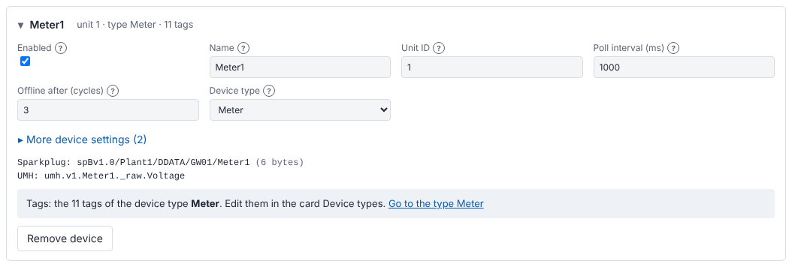

# Add devices of one type

This procedure tells how to keep the tag list of a device model one time, in a device type, and use it for two or more devices. Example: 10 energy meters of the same model, each with 40 tags. A change of one tag is then one change, not 10.

- For a device with its own tags, and for the fields of a tag, refer to [Add a Modbus device and its tags](add-a-modbus-device.md).
- For the keys and the rules, refer to [`device_types`](../reference/configuration.md#device_types).
- For the Sparkplug template of a type, refer to [Templates](../reference/sparkplug-messages-and-metrics.md#templates).

> **Warning: Do not use this document as verified data for the board.** The firmware has never run on the board (#1, #18). The images come from the firmware in QEMU.

## Before you start

You need:

- Access to the web UI of the gateway, with the web password.
- The register map of the device model. All the devices of the type use the same areas, addresses and types.
- The unit ID of each device.

Each device of a type gets a copy of the tags of the type. The copies count in the limit of 256 tags. For example, 4 devices of a type with 60 tags are 240 tags.

## 1. Make the type from a device

Use this procedure when one device of the model already has its tags in the gateway.

1. Click the tab **Configuration**.
2. In the card **Devices and tags**, open the device that has the tags.
3. Click **Make a type from these tags**.
4. In the dialog, type the **Name of the new type**, for example the model of the device: `Meter`. The name has 1 to 39 bytes, with no `/`, `+` or `#`.

   

5. Click **Make the type**. If the name is already the name of a type, the dialog gives an error below the field. Type a different name.

The new type gets a copy of the tags. The device then uses the type, and has no tags of its own.

## 2. Or make a new type

1. In the card **Device types**, click **+ device type**. The new type opens.
2. Type the **Name** of the type.
3. Add the tags with **+ tag**, as for the tags of a device. Refer to [Add the tags](add-a-modbus-device.md#4-add-the-tags).

   

The card **Device types** is closed by default. Its header shows the number of types and their names. Each type is a row that closes and opens. The browser keeps the open or closed state.

## 3. Add the other devices of the type

1. In the card **Devices and tags**, click **+ device** for each device.
2. Type the **Name** and the **Unit ID** of the device.
3. In the field **Device type**, select the type.
4. The dialog asks before the own tags of the new device go away. Click **Use the type**.

   If you click **Cancel**, the field goes back to **(none: own tags)**, and the device keeps its tags.

   

A device with a type has no tag table and no button **+ tag**. The grey box gives the number of the tags of the type. Click **Go to the type** to edit them. Each device keeps its own **Unit ID**, **Poll interval (ms)** and the other fields of the device.

## 4. Validate and save

1. Click **Validate** in the bar at the bottom of the window.
2. If the bar gives an error, click **Go to the field**. An error in a tag of a type opens the card **Device types** and the type, and shows below the field.
3. Click **Save and restart**.
4. On the host, make sure that the NBIRTH has the template definition of the type, and that the DBIRTH of each device has a template instance.

## Change or remove a type

- To change a tag for all the devices of the type, change it in the card **Device types**.
- To rename a type, change its **Name**. The devices of the type get the new name.
- To give one device its own tags again, select **(none: own tags)** in its field **Device type**. The device gets a copy of the tags of the type, as its own tags.
- **Remove type** is disabled while devices use the type. Give these devices another type, or **(none: own tags)**, first. The validation also refuses a device that gives a type that does not exist.

For UMH Core, a template instance gives no value. With `sparkplug.naming: "umh"`, the gateway sends the tags of a device with a type as plain metrics. Refer to [Connect the gateway to UMH Core](connect-to-umh-core.md).
