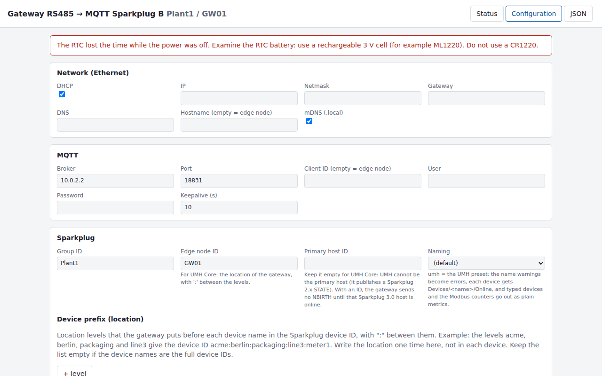

# Change, back up and restore the configuration

This document tells how to change the configuration of the gateway without a new flash, how to keep a copy of it, and how to load the copy again. The configuration is one JSON document (CFG-1, `docs/SPEC.md` §6).

- For the keys and their rules, refer to `docs/SPEC.md` §6 and §6.1.
- For the details of the implementation, refer to [`idf/README.md` §3.4](../../idf/README.md#34-configuration).

> **Warning: Do not use this document as verified data for the board.** The firmware has never run on the board (#1, #18). The procedures and the messages come from the firmware in QEMU.

## Before you start

You need one of these:

- The web UI, with the web password. This is the usual path.
- The REST API, with the web password, for example from a script.
- The USB console of the board (115200 baud). This path needs no password.

The three paths use the same validation. After a save, the gateway does an orderly restart: it sends the NDEATH, and then it restarts with the new document. Each save stops the polling and the Sparkplug session for some seconds.

## The secrets in the document

The gateway keeps `mqtt.password`, `network.wifi.password` and `web.password` in NVS, not in the document. An export shows each secret that has a value as `"********"`. When you load a document:

| Value of the secret | Result |
|---|---|
| `"********"` | The gateway keeps the stored secret |
| A new text | The gateway replaces the secret |
| `""` | The gateway deletes the secret |
| The key is not in the document | The gateway deletes the secret |

> **Caution: Keep `web.password` as `"********"` in each document that you load.** A document without this key removes the web password. The web password is also the Wi-Fi password of the access point.

## Change the configuration in the web UI

1. Open the web UI: `https://<ip>/` or `https://<hostname>.local/`.
2. Click the tab **Configuration**. Change the values in the forms.

   

3. For a key that has no form (for example Wi-Fi, IPv6, syslog, TLS), click the tab **JSON**. Change the document.
4. Click **Validate**. Read the message under the buttons.
5. If the message gives an error, correct the value. The message gives the JSON path or the line and the column. The web UI marks the field.
6. Click **Save and restart**. The page loads again after 15 s.

| Message | Meaning |
|---|---|
| `The configuration is valid.` | You can save |
| `The configuration is valid.` and warnings | You can save. The warnings are name checks for UMH Core |
| `Error 400: devices[1].tags[2].type: invalid value …` | Correct the value at this JSON path |
| `Error 400: JSON syntax error at line 5, column 3 …` | Correct the JSON in the JSON tab |
| `Error 409: testing <version>: N s left` | A new firmware image is on trial. Wait, then save again |
| `Error 413` | The document is larger than 128 KiB |

## Back up the configuration

1. In the web UI, click **Export**. The browser downloads the document.
2. Keep the file in a safe place. Write the web password, the MQTT password and the Wi-Fi password in your password manager. The file does not contain them.

From a script, use the REST API. Each write needs the header `X-Requested-With`. A read does not:

```sh
curl -k -u admin:<web password> "https://<ip>/api/config?download=1" -o gw01-config.json
```

`-k` accepts the self-signed certificate. To examine the certificate, compare its SHA-256 fingerprint with the fingerprint on the console of the gateway.

## Restore the configuration

### On the same gateway

The stored secrets stay, because the copy has `"********"`.

1. In the web UI, click **Import**, and select the file. The web UI shows the document in the JSON tab.
2. Examine the document.
3. Click **Validate**, then click **Save and restart**.

With the REST API:

```sh
curl -k -u admin:<web password> -H "X-Requested-With: curl" -X PUT \
     --data-binary @gw01-config.json "https://<ip>/api/config"
```

Add `?dry_run=1` to the URL to validate only.

### On a new gateway, or after a factory reset

A new gateway has no stored secrets. A `"********"` then gives no value.

1. Open the copy in a text editor.
2. Replace each `"********"` with the secret in clear text.
3. Load the document with **Import** in the web UI, with the REST API or with the shell (below).
4. Delete the copy with the secrets in clear text.

The gateway moves the secrets into NVS. A later export shows them as `"********"` again.

## Change the configuration from the USB console

Use this path when the web UI is not available, or when nobody knows the web password.

1. Connect a computer to the USB-C connector of the board.
2. Open a serial terminal at 115200 baud, for example `idf.py -p <port> monitor`.
3. Type `config show`. Copy the document.
4. Change the copy in a text editor.
5. Type `config load`, and push Enter.
6. Paste the document. The paste ends when the outer object of the document closes.
7. Read the result. With an error, the gateway keeps the old configuration.

To validate only, type `config check` in step 5. To stop a paste, type `.` alone on a line.

The shell has no password: the console needs physical access to the board. A build without `CONFIG_GW_SHELL_WRITE_COMMANDS` has no `config load` and no `config check`.

## If the gateway rejects the stored configuration

A document in `/cfg/config.json` that is not valid puts the gateway in recovery mode. The polling and MQTT do not start. The LED blinks red, fast. The web UI shows the cause in a red banner, and the log gives it every 10 s.

1. Open the web UI. The gateway uses the network of the last valid configuration, or DHCP. The access point also starts.
2. Read the cause in the banner.
3. Correct the document in the Configuration tab or the JSON tab.
4. Click **Validate**, then click **Save and restart**.

For the other causes of recovery mode, refer to [Recover a gateway](recover-the-gateway.md).
