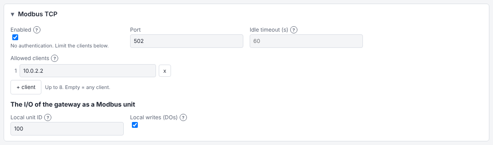
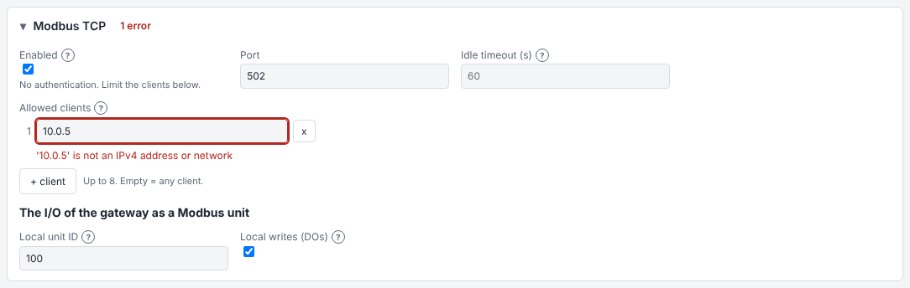

# Connect a Modbus TCP client

This procedure tells how to give a Modbus TCP client, for example a PLC or a SCADA, access to the RS485 devices through the gateway. It also tells how to let the client read the inputs and outputs of the gateway itself.

- For the keys of `modbus_tcp` and the exceptions of the gateway, refer to [The configuration document](../reference/configuration.md#modbus_tcp).
- For the registers and the exceptions of the local unit, refer to [The local unit](../reference/configuration.md#the-local-unit).
- For the limits of the server, refer to [Known limitations](../reference/known-limitations.md#modbus-tcp-mb-15).
- For UMH Core as the client, refer to [Use Modbus TCP as a second path](connect-to-umh-core.md#use-modbus-tcp-as-a-second-path).

> **Warning: Do not use this document as verified data for the board.** The firmware has never run on the board (#1, #18). The RS485 hardware mode and the local I/O are compile-only. The E2E examines the Modbus TCP server and the local unit in QEMU. The images come from the firmware in QEMU.

> **Caution: Add only the clients that must have access.** Modbus TCP has no authentication: a permitted client can read and write each register of each slave on the bus. The write limits of the tags do not apply to these requests.

## Before you start

You need:

- The web UI, with the user name and the web password.
- The IPv4 address or the IPv4 network of each client. The server does not listen on IPv6.
- The unit ID of each RS485 device. The field **Unit ID** of the device in the card **Devices and tags** gives it.
- A network path from each client to the gateway on Ethernet or on the Wi-Fi network. The gateway refuses a client that connects through its access point.

The server starts only in normal mode. A save restarts the gateway. The gateway sends the NDEATH, and the polling and the Sparkplug session stop for some seconds.

## Enable the server

1. Open the web UI: `https://<ip>/` or `https://<hostname>.local/`.
2. Click the tab **Configuration**.
3. Go to the card **Modbus TCP**, in the group **Services**.

   

4. Select **Enabled**.
5. Keep **Port** empty for the default port 502, or type a different port: 1 to 65535.
6. As an option, type a time in **Idle timeout (s)**: 0 to 3600. The gateway closes a connection that sends no request for this time.

An empty **Idle timeout (s)** is 60 s. With 0, the gateway does not close a connection without requests.

## Limit the clients

1. Below **Allowed clients**, click **+ client**. The card adds an empty row.
2. In the row, type the address of the client (`a.b.c.d`) or its network (`a.b.c.d/n`).
3. Do steps 1 and 2 again for each client. The list has 8 rows at most.
4. To remove a client, click **x** in its row.

> **Caution: Do not keep the list empty.** With an empty list, each computer that can reach the port can read and write each slave on the bus. The gateway then writes a warning to the log.

A network gives access to each address in it. Thus use an address, or the smallest network that contains the clients. The gateway compares only the source address of a connection with the list. For the limits of this filter, refer to [Known limitations](../reference/known-limitations.md#modbus-tcp-mb-15).

## Let a client read the I/O of the gateway

This procedure is optional. The gateway can answer one unit ID itself, the local unit. A client then reads the DIs, the DOs, the pulse counters and the run hours of the gateway on this unit. The gateway does not send the requests for this unit to the RS485 bus.

1. Go to the section **The I/O of the gateway as a Modbus unit** of the card **Modbus TCP**.
2. In **Local unit ID**, type a unit ID from 1 to 247. Empty or 0 = no local unit.
3. Make sure that no slave on the bus has this unit ID. The clients cannot reach a slave with the unit ID of the local unit.
4. Select **Local writes (DOs)** only when a client must switch the DOs.

> **Warning: Make sure that it is safe to switch the DOs before you select Local writes (DOs).** Each permitted client can then switch each DO, and a machine on an output can start or stop.

Without **Local writes (DOs)**, the clients can only read the local unit.

The local unit gives the run hours only for the channels that count them:

1. Go to the card **Local I/O** of the Configuration tab.
2. In the row of each DI or DO, select **Run hours**.

A channel without **Run hours** gives 0. Refer to [Count the run hours of a machine](set-up-the-local-io.md#count-the-run-hours-of-a-machine).

## Save the configuration

1. Click **Validate** in the bar at the bottom of the window.
2. If the bar gives an error, click **Go to the field**. Read the error below the field, and correct the value.
3. Click **Save and restart**. The page loads again after 15 s.

The validation gives these errors, for example:

- "'10.0.5' is not an IPv4 address or network" below a row of **Allowed clients**. An empty row also gives this error: type an address, or remove the row.
- "Unit 100 is the Unit ID of the device Pump1" below **Local unit ID**. Type a unit ID that no device has.

## Make sure that the server operates

1. In the client, set the address of the gateway, the port and the protocol Modbus TCP.
2. From the client, read a register that a tag of an RS485 device uses. Use the unit ID of the device.
3. In the Status tab of the web UI, compare the value with the column **Values** of the card **Modbus devices**.
4. In the Status tab, click **Log** to open the card. Refer to [Read the live log](read-the-live-log.md).
5. Find the line `mbtcp: client <address> connected` in the log.

The client gets the register as the device gives it. The column **Values** shows the value of the tag after its scale and its offset.

If the gateway has a local unit, read it from the client, with **Local unit ID** as the unit ID. Compare each value with the card **Local I/O** of the Status tab:

| Read from the client | Content | Compare with |
|---|---|---|
| Discrete inputs 0 to 7 (FC02) | DI 1 to DI 8 | The column **State** of the table **Digital inputs** |
| Coils 0 to 7 (FC01) | DO 1 to DO 8 | The column **State** of the table **Digital outputs** |
| Input registers 0 to 31 (FC04) | The pulse counters of DI 1 to DI 8 | The column **Counter** of the table **Digital inputs** |
| Input registers 32 to 63 (FC04) | The run hours of DI 1 to DI 8, in seconds | The column **Run hours** of the table **Digital inputs**, in hours |
| Input registers 64 to 95 (FC04) | The run hours of DO 1 to DO 8, in seconds | The column **Run hours** of the table **Digital outputs**, in hours |

- Each counter and each run hours value has 4 registers: an unsigned integer of 64 bits, with the most significant register first.
- The addresses of the table start at 0, as in the Modbus request. Some clients show numbers that start at 1.

The web UI does not show the counters of the Modbus TCP server. As a complement:

- The shell command `devices` gives the line `modbus_tcp`. It has the accepted and the rejected connections, the forwarded requests, the exceptions of the gateway and the requests to the local unit.
- For a device that got Modbus TCP requests, the line of the device in `devices` shows `| tcp ok … timeout … crc … frame … exception …`.
- A Sparkplug host gets the counters of each unit in the node metric `Node Info/Modbus TCP`. Refer to [Diagnostics](../reference/sparkplug-messages-and-metrics.md#diagnostics).

## If the client gets no response

Read the log of the gateway first: the tag `mbtcp` gives the cause of each connection that the gateway refuses or closes.

| Symptom | Line in the log, after `mbtcp:` | Cause and correction |
|---|---|---|
| The client cannot connect | No line | The connection does not get to the server. Make sure that **Enabled** is selected and saved, and that the client uses the port of **Port**. Make sure that the card **Gateway** of the Status tab shows the mode `normal`. Examine the network path and the firewall between the client and the gateway |
| The gateway closes the connection at once, without a response | `connection from <address> refused: not in modbus_tcp.allowed_clients` | The address of the client is not in **Allowed clients**. Add it |
| | `connection from <address> refused: through the access point` | The client connects through the access point of the gateway. Use Ethernet or the Wi-Fi network. While the access point runs, the gateway also refuses each client with an address in the network of the access point |
| | `connection from <address> refused: 2 clients already connected` | The server has 2 clients, its maximum (the build option `CONFIG_GW_MBTCP_MAX_CLIENTS`). Close a connection that is not necessary |
| The gateway closes the connection after the first request | `client <address> closed: not a Modbus TCP frame` | The bytes from the client are not a Modbus TCP frame. Make sure that the client uses the protocol Modbus TCP, not RTU over TCP |
| The gateway closes the connection after a time without requests | `client <address> closed: idle` | **Idle timeout (s)** came to its end. Make the client connect again, or type a longer time |

## If the client gets an exception

An RS485 device can send an exception, for example 02 for an address that it does not have. The gateway sends this exception to the client without a change. The gateway and the local unit also send these exceptions themselves:

| Code | From the gateway, for a unit on the bus | From the local unit |
|---|---|---|
| 01 | The function is not FC01 to FC06, FC15 or FC16 | FC03, FC06 or FC16: the local unit has no holding registers. Also FC05 and FC15 without **Local writes (DOs)** |
| 02 | — | An address that the local unit does not have, or a read that goes past the end of an area |
| 03 | The data of the request is not valid, for example a quantity of 0 | A write to a DO that a local rule drives |
| 04 | — | The DO expander does not answer, or the gateway did not apply the write |
| 0A | The unit ID is 0, or 248 to 255. Use the unit ID of a device or of the local unit | — |
| 0B | The device did not respond after the retries (**Retries** of the card **RS485**). Or the bus was not free in time | — |

For the exception 0B, make sure that the device is online in the card **Modbus devices** of the Status tab. Refer to [Connect the RS485 bus](connect-the-rs485-bus.md#if-there-is-a-problem).
