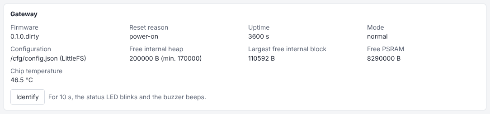

# Find the gateway in a panel

This document tells how to find the gateway that has its web UI open in your browser, when a panel holds a number of gateways.

- For the LED patterns and the beeps, refer to [The status signals](../reference/status-signals.md#status-led).
- To give each gateway a name and a location in the header of the web UI, refer to [`gateway`](../reference/configuration.md#gateway).

> **Warning: Do not use this document as verified data for the board.** The firmware has never run on the board (#1, #18). The LED and the buzzer are compile-only. The E2E reads the patterns from the log of the firmware in QEMU.

1. Open the web UI of the gateway, and go to the Status tab.
2. In the card **Gateway**, click **Identify**.
3. Look at the panel. For 10 s, the status LED of the gateway shows red, green and blue in turn, and its buzzer beeps.

During the 10 s, the button is disabled, and the card gives the seconds left.

You can also start the identify with:

- the REST API: `POST /api/identify`;
- the shell: `identify`.
