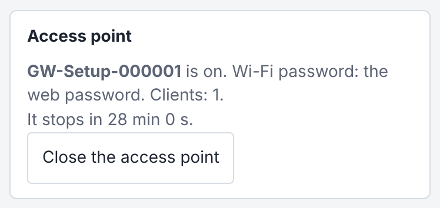
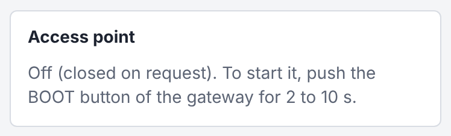

# Get on the access point on a later visit

This procedure tells how to open the web UI of a gateway through its access point when a web password is set. Use it at the panel, for example when the plant network is down or when you are not on the plant network. The Wi-Fi password of the access point is the web password (issue #187).

- For the first web password, refer to [Set the first web password on site](set-the-first-web-password.md).
- For the keys, the times and the signals of the access point, refer to [The access point](../reference/access-point.md).
- For the reasons and the residual risks, refer to [The security of the access point](../explanation/access-point-security.md).

> **Warning: Do not use this document as verified data for the board.** The firmware has never run on the board (#1, #18). The radio of the access point is compile-only. Nobody has examined the web password as the Wi-Fi password on the board yet (#130 item N9). The images come from the firmware in QEMU.

## Before you start

You need:

- Physical access to the board: the BOOT button and the status LED.
- A phone or a laptop with Wi-Fi and a browser.
- The web user name and the web password of the gateway.

When nobody knows the web password, refer to [If nobody knows the web password](#if-nobody-knows-the-web-password).

## Procedure

1. Push the BOOT button for 2 to 10 s. Release it when the LED blinks white.
2. Make sure that you hear 1 beep. If you hear no beep, the gateway did not complete its boot: wait, then do step 1 again.
3. Make sure that the LED shows a short cyan flash each 2 s. This shows that the access point is on, with WPA2.
4. On the phone, connect to the Wi-Fi network `GW-Setup-XXXXXX` in 5 min or less. Use the web password as the Wi-Fi password. `XXXXXX` is the end of the MAC address of the board.
5. Open `https://192.168.4.1/` in the browser. Accept the certificate of the gateway (it is self-signed). Type the web user name and the web password in the login dialog of the browser.
6. Do the work in the web UI.
7. When you complete the work, close the access point:
   1. On the Status tab, find the card "Access point".

      

   2. Click "Close the access point". A confirmation opens at the bottom of the screen.
   3. Read the confirmation. It tells that the page stops, because this phone uses the access point.

      

   4. Click the red button "Close the access point". To keep the access point on, click "Cancel".
   5. Wait until the phone loses the connection. The access point stops approximately 2 s after the click.
8. Make sure that the LED shows no cyan flash.

After step 7, a new visit to the Status tab (for example from the plant network) shows that the access point is off:

The access point also stops without step 7:

- 5 min after the last client disconnects (`CONFIG_GW_SOFTAP_IDLE_MIN`).
- In normal mode, 30 min after the push of BOOT (`CONFIG_GW_SOFTAP_TIMEOUT_MIN`), also with a client.

To get more time, push BOOT for 2 to 10 s again. This starts the times again. With the USB console, the shell command `ap stop` also closes the access point.

## If the phone does not connect

| Problem | What to do |
|---|---|
| The phone does not show `GW-Setup-XXXXXX` | The access point stopped (no client for 5 min, or the maximum time). Do step 1 again |
| The phone refuses the Wi-Fi password | Make sure that you use the web password. A web password that an earlier firmware set does not open the access point: the key is then the commissioning password, until the next change of the web password. Change the web password from the plant network, or use the USB console |
| The browser does not open `https://192.168.4.1/` | Make sure that the phone is on `GW-Setup-XXXXXX`. Some phones leave a Wi-Fi network without Internet: tell the phone to stay on it |
| The browser refuses the web password (HTTP 401, then 429) | After 5 refused attempts, the gateway blocks your address for 30 s or more. Wait, then type the password again |

## If nobody knows the web password

The claim window does not open again while a web password is set (decision of #120). There are two paths:

- **With a computer and a USB cable at the panel:** set a new web password through the shell. This keeps the configuration. Refer to [Recover a gateway](recover-the-gateway.md#with-the-usb-console).
- **Without a computer:** do a factory reset, then set a new first web password.

> **Caution: Make sure that you have the configuration of the plant and its secrets before the factory reset.**
> The factory reset erases the configuration, the secrets (for example the MQTT password) and the certificate of the web UI. The gateway stops its work until it gets a new configuration.

To do a factory reset:

1. Push the BOOT button for more than 10 s. At 2 s, the LED changes to white.
2. Release the button after you hear 2 beeps. The gateway erases the configuration and restarts in commissioning mode.
3. Do the procedure [Set the first web password on site](set-the-first-web-password.md).
4. Load the configuration of the plant in the web UI.
