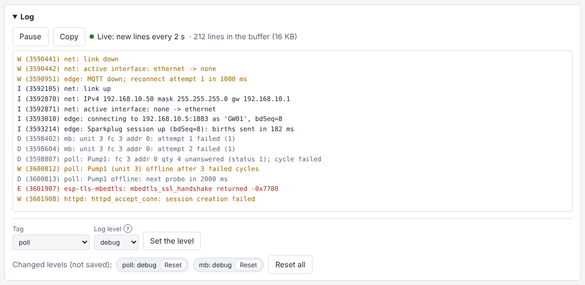

# Read the live log

This document tells how to read the log of the gateway in the web UI, and how to change the log level of a part of the firmware (a tag). You do not need a USB console or a syslog server.

- For the routes, refer to [The REST API](../reference/rest-api.md#get-apilog).
- For the syslog copy of the log, refer to [`syslog`](../reference/configuration.md#syslog).

> **Warning: Do not use this document as verified data for the board.** The firmware has never run on the board (#1, #18). The E2E tests the log routes in QEMU.

From the boot on, the gateway keeps the last log lines in a buffer of 16 KB in PSRAM. The card **Log** of the Status tab shows them. The page reads the log only while the card is open. When you close the card, the page stops the requests.

## Read the log

1. Open the web UI, and go to the Status tab.
2. Click **Log** to open the card. The card shows the last lines, and adds the new lines each 2 s.
3. To keep the view while you read, click **Pause**. The new lines wait. Click **Resume** to show them.
4. To copy the lines, click **Copy**. Then paste the lines, for example, into an issue.

The colors show the severity of each line: brown for a warning, red for an error and grey for a debug line. A line "lines lost" tells that the buffer was full between two requests. A line "the gateway restarted" tells that the numbers of the lines started again.

## Change the log level of a tag

The level of a tag is the lowest severity that the tag writes to the log. The level applies to the console, to the syslog copy and to this card. The gateway does not save a change: a restart sets each tag to `info` again.

> **Caution: Set the level to `info` again after the diagnosis.** The `debug` and `verbose` levels of a busy tag write many lines. The syslog copy and the console then get more data.

1. Open the card **Log**.
2. In **Tag**, select the part of the firmware, for example `poll` for the polling or `mb` for the Modbus master. The tag `*` sets all the tags.
3. In **Log level**, select the level, for example `debug`.
4. Click **Set the level**. The card shows the new level below the lines, in **Changed levels (not saved)**.
5. To set one tag to the level of the build again, click **Reset** next to it. To do this for all the tags, click **Reset all**.

`syslog.level` of the configuration filters only the copy to the syslog server. It does not change the log level of a tag.

You can also change the level with:

- the REST API: `POST /api/log/level` with `{"tag": "poll", "level": "debug"}`, or `{"reset": true}`;
- the shell: `log poll debug`, `log reset`, and `log` to show the levels and the tags.
