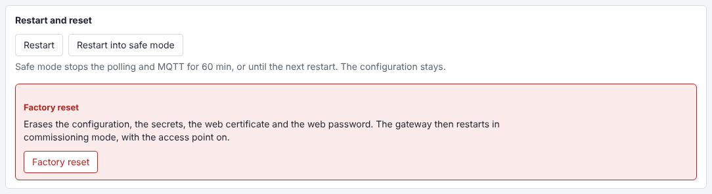

# Restart into safe mode or do a factory reset

This document tells how to restart the gateway into safe mode, and how to do a factory reset, from a distance. Use the web UI, the REST API or the shell. You do not have to go to the panel.

- For the modes and the LED patterns, refer to [The status signals](../reference/status-signals.md).
- For the routes, refer to [The REST API](../reference/rest-api.md#safe-mode-on-request).
- To do a factory reset at the panel with the BOOT button, refer to [Recover a gateway](recover-the-gateway.md#do-a-factory-reset).

> **Warning: Do not use this document as verified data for the board.** The firmware has never run on the board (#1, #18). The E2E tests these procedures in QEMU.

The card **Restart and reset** is the last card of the Status tab. It has the buttons **Restart** and **Restart into safe mode**, and a red box with the button **Factory reset**.

## Restart into safe mode

In safe mode, the gateway does not poll and does not connect to MQTT. The hosts get the NDEATH and show the tags as stale. The network, the web UI, the shell, the access point and the firmware upload operate. The configuration stays.

Use safe mode, for example, when you must update the firmware with the polling stopped.

> **Caution: Make sure that the plant can operate without this gateway for up to 60 min.** In safe mode, the gateway reads and writes no Modbus device, and it publishes no data.

1. Open the web UI, and go to the Status tab.
2. In the card **Restart and reset**, click **Restart into safe mode**.
3. In the confirmation, make sure that the first line gives the correct gateway: the name, the edge node ID, the address and the firmware.

   

4. Click the red button **Restart into safe mode**.
5. Wait for the restart. Then the page shows the banner "Safe mode on request", with the time left.

In safe mode, the card **Gateway** gives the mode `recovery (safe mode)`. The card **Firmware** gives the cause and the time left. The button **Restart into safe mode** is disabled.

To end safe mode, click **Restart**. The gateway starts in normal mode. Safe mode also ends after 60 min, or at a power cycle.

You can also restart into safe mode with:

- the REST API: `POST /api/restart?safe=1`;
- the shell: `restart safe`.

The gateway refuses a restart into safe mode during a firmware update, during the trial of a new image, and in safe mode.

## Do a factory reset

The factory reset erases:

- the configuration;
- the secrets, for example the MQTT password;
- the certificate of the web UI;
- the web password;
- the pulse counters and the run hours of the local I/O.

Then the gateway restarts in commissioning mode: no polling and no MQTT until it gets a new configuration. The restart also sets the Modbus counters to 0. The access point starts with a new commissioning password. Only the serial console shows this password.

> **Caution: Export the configuration first, if you need it again.** After the factory reset, the gateway has no configuration and no secrets.

1. Open the web UI, and go to the Status tab.
2. In the red box **Factory reset** of the card **Restart and reset**, click **Factory reset**.
3. In the confirmation, make sure that the first line gives the correct gateway.
4. If you need the configuration again, click **Export the configuration**. Keep the file.
5. Type `ERASE` in the field. The red button **Erase and restart** becomes enabled.

   

6. Click **Erase and restart**.
7. Wait for the restart. The page stops, because the web password and the certificate are erased.

After the restart, the LED blinks blue: commissioning mode. To configure the gateway again, refer to [Recover a gateway](recover-the-gateway.md#the-gateway-has-no-configuration).

If the power goes off during the factory reset, connect the power again. The gateway completes the reset at the next start, then it restarts in commissioning mode. If the gateway starts with the old configuration, the reset did not start: do the factory reset again. For the sequence, refer to [Commissioning and secrets](../reference/commissioning-and-secrets.md#the-sequence-of-the-factory-reset).

You can also do the factory reset with:

- the REST API: `POST /api/factory-reset?confirm=1`;
- the shell: `factory-reset`. The shell asks for the word `ERASE`. Another answer erases nothing.

For the reasons of the commissioning mode, refer to [The security of the access point](../explanation/access-point-security.md).
