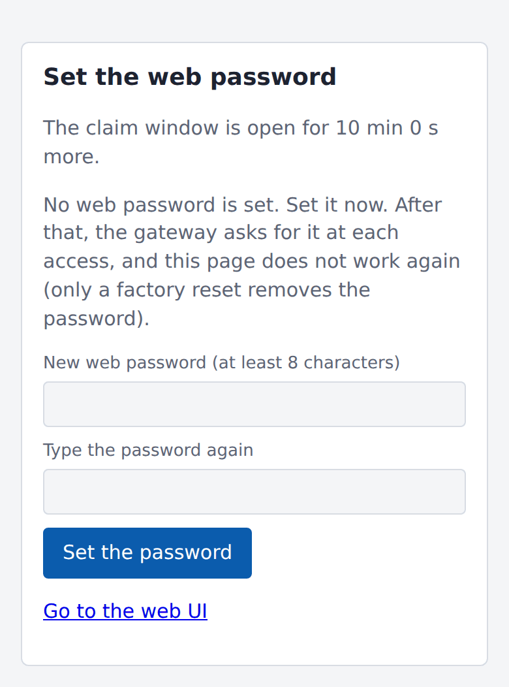

# Set the first web password on site

This procedure tells how to set the first web password of an installed gateway without a computer at the panel. It uses the claim window (issue #120). The web password is also the Wi-Fi password of the access point (issue #187).

- For the keys, the times and the signals of the access point, refer to [The access point](../reference/access-point.md).
- For the reasons and the residual risks, refer to [The security of the access point](../explanation/access-point-security.md).
- For the rules of the claim window, refer to [Commissioning and secrets](../reference/commissioning-and-secrets.md#the-claim-window-cfg-8). For the reasons for the rules, refer to [The security of the web UI and the claim window](../explanation/web-and-claim-security.md#why-the-claim-window-has-these-rules).

> **Warning: Do not use this document as verified data for the board.** The firmware has never run on the board (#1, #18). The access point and its open period are compile-only. The E2E tests the window in QEMU over the emulated Ethernet. The images come from the firmware in QEMU.

> **Caution: Stay at the panel until you set the password.** Until the claim, the access point has no key. Another person in the radio range can connect and set the password first.

## Before you start

You need:

- Physical access to the board: the BOOT button and the status LED.
- A phone or a laptop with Wi-Fi and a browser.
- A new web password: 8 to 63 characters. Use only the letters A to Z and a to z, the digits, the space and the symbols of a keyboard (printable ASCII). The gateway refuses other letters, for example `é` or `ñ`.

The window opens only when no web password is set. This is the case on a new gateway, after a factory reset, and on a gateway that never got a web password. When a web password is set, refer to [Get on the access point on a later visit](get-on-the-access-point.md).

## The signals of the gateway

| Signal | What it tells |
|---|---|
| LED white, blinks fast (from 2 s of the push) | Release the button now for the access point and the window. At 10 s, the gateway does a factory reset |
| 1 beep when you release the button | The access point starts, and the claim window opens |
| No beep when you release the button | The gateway did not complete its boot, and it ignored the push. Wait, then push again |
| LED blue and white, alternately | The claim window is open. The access point has no key |
| 1 beep after you set the password | The gateway stored the password. The window is closed |
| LED with a short cyan flash each 2 s | The access point is on, with WPA2 |
| LED blue, blinks slowly | Commissioning: the gateway has no configuration (after a factory reset) |

## Procedure

1. Push the BOOT button for 2 to 10 s. Release it when the LED blinks white.
2. Make sure that you hear 1 beep, and that the LED shows blue and white, alternately.
3. On the phone, connect to the Wi-Fi network `GW-Setup-XXXXXX` in 5 min or less. The network has no key during the window. `XXXXXX` is the end of the MAC address of the board.
4. Open the secure page of the gateway in the browser:
   1. Wait for the captive portal window of the phone. Android shows "Sign in to GW-Setup-XXXXXX". iOS shows a sheet with the name `GW-Setup-XXXXXX`.
   2. Make sure that the window shows the guide page of the gateway. The guide page tells that the Wi-Fi network is open until you set the web password.
   3. On the guide page, click "Open in the browser".
   4. If the guide page shows "The address is in the clipboard", close the window. On iOS, tap "Cancel", then "Use Without Internet". Open the browser, and paste the address.
   5. If no window opens in 10 s, open `https://192.168.4.1/` in the browser.
   6. Accept the certificate of the gateway (it is self-signed). The browser goes to the page "Set the web password".

   The guide page has no field for a password. Set the web password only on the secure page `https://192.168.4.1/`. For the guide page, refer to [The captive portal](../reference/access-point.md#the-captive-portal).

   

5. Type the new password two times. Click "Set the password".
6. Make sure that the page shows "The web password is set". Record the network name and the addresses that the page shows.

   

7. Wait until the phone loses the connection. 5 s after the claim, the access point changes to WPA2 with the new password.
8. Connect the phone again to `GW-Setup-XXXXXX`. Use the new web password as the Wi-Fi password.
9. Open `https://192.168.4.1/` as in step 4: the phone can show the guide page again. Type the user name and the new password in the login dialog of the browser. In commissioning and in recovery, any user name is valid.
10. Make sure that the web UI opens.

You can now do the work in the web UI. When you complete the work, close the access point: refer to [Get on the access point on a later visit](get-on-the-access-point.md), step 7. From a computer on the plant network, use the addresses of step 6: `https://<ip>/` or `https://<hostname>.local/`.

## Times

- The window is open for 10 min after the push (`CONFIG_GW_WEB_CLAIM_WINDOW_MIN`). Another push of BOOT starts the time again.
- When no client connects for 5 min (`CONFIG_GW_SOFTAP_IDLE_MIN`), the access point stops, and the window closes before the end of its 10 min. Do step 1 again.
- At the end of the window without a claim, the access point uses WPA2 with the commissioning password. Do step 1 again.

## If the page refuses the password

| Message | What to do |
|---|---|
| "No claim window is open" | The time is over, the access point stopped, or you did not push BOOT. Do step 1 again |
| "accepts only a client of the access point" | You are on the plant network. Connect to `GW-Setup-XXXXXX` (step 3) |
| The browser does not open `https://192.168.4.1/` (step 4) | Make sure that the phone is on `GW-Setup-XXXXXX`. The network has no Internet: tell the phone to stay on it. If the phone uses the mobile data for the browser, turn off the mobile data |
| "a web password is set" | Somebody set the password. If it was not you, do a factory reset (push BOOT for more than 10 s), then do this procedure again |
| "Use 8 to 63 characters", or "the web password must have …" | Type a password that obeys the rule. Do not use letters with accents |
| "The two passwords are not the same." | Type the same password in the two fields |
| HTTP 429 | Too many refused attempts from your address. Wait 30 s or more |

## If the phone does not connect again (step 8)

- Make sure that you use the new web password as the Wi-Fi password. Some phones keep the open network: tell the phone to forget the network `GW-Setup-XXXXXX`, then connect again.
- If the access point stopped, push BOOT for 2 to 10 s. The access point starts again with WPA2 and the web password. The claim window does not open again.

## After the procedure

- Load the configuration of the plant in the web UI. Refer to [Change, back up and restore the configuration](change-the-configuration.md). In the card **Web interface**, keep `********` in the field **Password (8 to 63)**: this keeps the stored password and the Wi-Fi password of the access point.
- If the web UI asks "Remove the web password?" before the save, click **Cancel**. The document then has no web password, or an empty one. Refer to [Change the web password](change-the-web-password.md#do-not-remove-the-web-password-by-mistake).
- The window does not open again while a web password is set. Only a factory reset removes the password.
- On a later visit, refer to [Get on the access point on a later visit](get-on-the-access-point.md).
