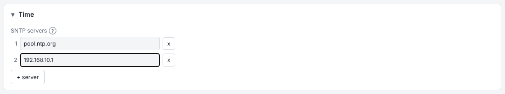

# Set the time servers

This procedure tells how to set the SNTP servers of the gateway in the web UI, for example the NTP server of the site. It also tells how to make sure that the clock is valid.

- For the key `ntp.servers`, refer to [The configuration document](../reference/configuration.md#ntp).
- For the sources of the clock and the signals of the wait, refer to [The clock and the RTC battery](../reference/clock-and-rtc-battery.md).

> **Warning: Do not use this document as verified data for the board.** The firmware has never run on the board (#1, #18). The E2E examines the SNTP servers and the wait for a valid clock in QEMU. The images come from the firmware in QEMU.

Without a valid clock, the gateway opens no MQTT session and sends no NBIRTH. The default server is `pool.ntp.org`. In a plant, the firewall often blocks this server. Then use the NTP server of the site.

## Before you start

You need:

- The web UI, with the user name and the web password.
- The name, the IPv4 address or the IPv6 address of each server: 1 to 127 bytes. The gateway uses 3 servers at most.
- A network path from the gateway to UDP port 123 of each server.
- For a server with an IPv6 address: IPv6 on the gateway (**Enabled** in the card **IPv6**).
- For a server with a name: a DNS server that knows the name. Without DHCP, the field **DNS** of the card **Network (Ethernet)** or **Wi-Fi** gives the DNS server.

A save restarts the gateway. The gateway sends the NDEATH, and the polling and the Sparkplug session stop for some seconds.

## Set the servers

1. Open the web UI: `https://<ip>/` or `https://<hostname>.local/`.
2. Click the tab **Configuration**.
3. Go to the card **Time**. Below **SNTP servers**, the card has one row for each server.

   

4. In row 1, type the name or the address of the NTP server of the site.
5. To add a server, click **+ server**. Then type the server in the new row.
6. To remove a server, click **x** in its row.
7. If the gateway cannot reach the internet, remove `pool.ntp.org`.

The card has these rules:

- An empty row 1 with the text `pool.ntp.org (default)` shows that the configuration has no list. The gateway then uses `pool.ntp.org`. When you type a server in this row, the gateway uses only your server.
- With 3 rows, the button **+ server** is not available, and the card shows "3 servers at most."
- With one row, the button **x** is not available. Type the new server in the row, in place of the old server.
- The button **(?)** next to **SNTP servers** opens a short explanation.

The gateway asks the server of row 1 first. It waits 15 s for a server that does not answer, and then it asks the server of the next row. Thus put the server that the gateway can reach in row 1.

## Save the configuration

1. Click **Validate** in the bar at the bottom of the window.
2. If the bar gives an error, click **Go to the field**. Read the error below the field, and correct the value.
3. Click **Save and restart**. The page loads again after 15 s.

For example, an empty row gives the error "Cannot be empty" below its field. Type a server in the row, or remove the row.

## Make sure that the clock is valid

1. Click the tab **Status**.
2. In the card **Local I/O**, find the line that starts with `Time:`.
3. Make sure that the line shows `synchronized by SNTP`.

   

4. In the card **Network and MQTT**, make sure that the first line shows `MQTT connected`.

The line `Time:` shows the source of the clock:

| Text of the line | Meaning |
|---|---|
| `synchronized by SNTP` | A server answered. The text stays until the next restart |
| `from the RTC (not synchronized)` | The clock is valid, with the time of the RTC. No server answered yet |
| `set from the browser (not synchronized)` | The clock is valid, with the time of a computer. No server answered yet |
| `no valid time: no MQTT session until the time is valid` | No source set the clock. The gateway waits |

The RTC keeps the time during a restart. Thus, after the restart, the line can show `from the RTC (not synchronized)` first, and MQTT can connect before a server answers. Only `synchronized by SNTP` shows that a server answers.

While the gateway waits, the page shows the banner "Waiting for a valid clock". The card **Network and MQTT** then shows `MQTT waiting for a valid clock`.

## If no server answers

1. Wait 15 s for each server of the list. Then read the line `Time:` again.
2. In the Status tab, click **Log** to open the card. Refer to [Read the live log](read-the-live-log.md).
3. Find the lines of the tag `edge` in the log:

    | Text after `edge:` | Meaning |
    |---|---|
    | `waiting for a valid clock: …` | The gateway has no valid time. This line comes at the start of the wait, and then each 10 min |
    | `clock valid (source sntp) after a wait of N s: connecting` | A server answered after a wait of N s. The line comes only when the gateway waited for a valid clock |
    | `time synchronised` | The first answer of a server after the start of the gateway |

4. If N is large, examine the sequence of the servers. Each server that does not answer adds 15 s to the wait.
5. Put the server that answers in row 1.
6. If no line shows an answer, examine the firewall between the gateway and each server: UDP port 123 must be open.
7. For a server with a name, make sure that the DNS server of the gateway knows the name.

The gateway does not tell which server answered. As a complement, the shell command `ping <address>` examines the network path to a server. It does not examine UDP port 123.

## Set the time from the browser as a temporary step

Use this procedure when no server answers, and the gateway must send its data now. The web UI sends the time of your computer to the gateway.

> **Caution: Make sure that the clock of your computer is correct before you click the button.** The gateway uses this time for the timestamps of the data.

1. Click the tab **Status**.
2. In the card **Local I/O**, click **Set the time from the browser**.
3. Make sure that the text next to the button shows `Time set.`
4. Make sure that the line `Time:` shows `set from the browser (not synchronized)`.

The gateway connects to the broker at once. It also writes the time into the RTC. With the RTC battery, the time stays after a power cut. Refer to [Fit the RTC battery](fit-the-rtc-battery.md).

This time is valid, but it is not synchronized: the metric `Node Info/Time Synced` stays `false`. Correct the SNTP servers as soon as possible. When a server synchronized the clock, the gateway refuses the time of the browser, and the text starts with `Time not set (409)`.
