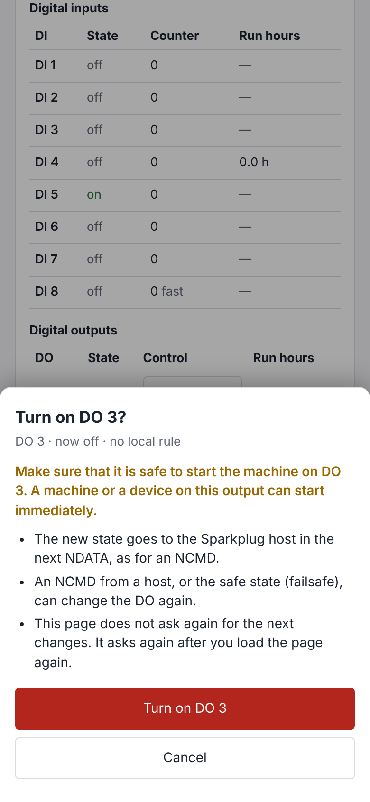

# Set up the local inputs and outputs

This procedure tells how to set the 8 digital inputs (DIs) and the 8 digital outputs (DOs) of the gateway in the web UI. It also tells how to set a DO from the Status tab, for example to make sure of the wiring.

- For each key of `local_io`, refer to [The configuration document](../reference/configuration.md#local_io).
- For the metrics `DI/n`, `DO/n`, `Counter/n` and `Run Hours/…`, refer to [The Sparkplug messages and metrics](../reference/sparkplug-messages-and-metrics.md#local-io).
- To set a DO from a Sparkplug host, refer to [Write a value to a Modbus device or a digital output](write-to-a-modbus-device.md).

> **Warning: Do not use this document as verified data for the board.** The firmware has never run on the board (#1, #18). The DIs, the DO expander and the PCNT units are not tested on the board yet (#126). The procedures and the images come from the firmware in QEMU.

## Before you start

You need the web UI, with the user name and the web password.

A save restarts the gateway. The gateway sends the NDEATH, and the polling and the Sparkplug session stop for some seconds. The DOs go to their restart state (column **Safe state**).

## Open the card Local I/O

1. Open the web UI: `https://<ip>/` or `https://<hostname>.local/`.
2. Click the tab **Configuration**.
3. Go to the card **Local I/O**.

![The card 'Local I/O' of the Configuration tab: Safe state after 5 s and Counter save interval 60 s. The table of the DIs has Invert, Debounce, Counter, Glitch filter and Run hours: DI 5 is inverted with a debounce of 200 ms, DI 8 is a fast (PCNT) counter with a glitch filter of 1000 ns, DI 4 counts its run hours. The table of the DOs has Safe state, Pulse, Local rule, Mode and Run hours: DO 7 is a pulse DO of 300 ms, DO 5 follows DI 2, DO 6 toggles with DI 3, DO 2 counts its run hours. Below are the alarms of the buzzer and Alarm after.](../images/local-io-card.png)

Each column has a **(?)** button. It opens a short explanation of the column, with its range and its default.

On a phone, the tables are wider than the screen. Push a table to the side to see more columns.

## Set a DI for a normally closed contact

A normally closed contact gives the active state at rest. Invert the DI to make it `true` when the contact opens.

1. In the table **Digital inputs**, find the row of the DI.
2. Select **Invert**.

The metric `DI/n`, the pulse counter and the local rules use the inverted state.

## Change the debounce of a DI

The input must stay in its new state for the debounce time before the gateway accepts the change. The default is 20 ms.

1. In the row of the DI, type the time in **Debounce (ms)**: 0 to 1000.
2. For a slow contact that bounces, use a longer time, for example 100 ms.

With 20 ms, the pulse counter counts up to approximately 25 Hz. For faster pulses, use a fast counter.

## Count fast pulses with a PCNT unit

Use a fast counter for a flow meter or an energy meter that gives more than approximately 25 pulses each second.

1. In the row of the DI, set **Counter** to `fast (PCNT)`.
2. Type the time of the **Glitch filter (ns)**: 0 to 12787. The PCNT unit ignores a shorter pulse. The default is 1000 ns.
3. Make sure that the text next to **Digital inputs** shows 4 fast counters or less, for example `Fast counters: 2 of 4 (PCNT units)`. The ESP32-S3 has 4 PCNT units.

The metric `Counter/n` does not change. The state of the DI still uses the debounce.

## Make a pulse DO

A pulse DO goes on for a time, and then off. Use it for a latching relay or a reset input.

1. In the table **Digital outputs**, find the row of the DO.
2. Type the time in **Pulse (ms)**: 50 to 60000. 0 is a normal DO.
3. Set **Safe state** to `off` or `hold`. The safe state `on` is not permitted for a pulse DO.
4. Set **Local rule** to `none`. A local rule is not permitted for a pulse DO.

A write of `true` (an NCMD, or the button of the Status tab) starts the pulse. The NDATA gives `true` and then `false`.

## Count the run hours of a machine

The gateway counts the time in the on state of a DI (for example a contact of the machine) or of a DO.

1. In the row of the DI or of the DO, select **Run hours**.
2. Make sure that **Counter save interval (s)** is not 0. Else the gateway loses the run hours at each restart.

The NBIRTH then has the metric `Run Hours/DI/n` or `Run Hours/DO/n`, in seconds. The Status tab shows the run hours in hours.

## Set the safe state of the DOs

1. In **Safe state after (s)**, type the time without a Sparkplug session before the DOs go to their safe state. 0 = a loss of MQTT does not change the DOs.
2. In the row of each DO, set **Safe state** to `off`, `on` or `hold`.

The same state applies after a restart. With `hold`, the DO keeps its state.

## Link a DI to a DO with a local rule

The gateway applies a local rule itself, also without the network.

1. In the row of the DO, set **Local rule** to the DI, for example `DI 2`.
2. Set **Mode**: `follow` (the DO has the state of the DI), `invert` (the opposite state), or `toggle` (each activation of the DI changes the DO).

A DO with a local rule has no button in the Status tab, and the gateway refuses an NCMD for it.

## Set the alarms of the buzzer

1. In **Buzzer**, select the alarms that must sound: **Configuration rejected**, **No MQTT session**, **Device offline**.
2. In **Alarm after (s)**, type the time that **No MQTT session** or **Device offline** must last before the buzzer sounds.

For the patterns of the beeps, refer to [The status signals](../reference/status-signals.md#buzzer).

## Save the changes

1. Click **Validate** in the bar at the bottom of the window.
2. If the bar gives an error, click **Go to the field**. Read the error below the field, and correct the value.
3. Click **Save and restart**. The page loads again after 15 s.

For example, a pulse DO with the safe state `on` gives the error "Not for a pulse DO. Use off or hold" below the field **Safe state**.

## Set a DO from the Status tab

Use the Status tab to make sure of the wiring of a DO, for example during the commissioning, when there is no Sparkplug host yet. The web UI writes only to the DOs, never to the Modbus devices.

> **Warning: Make sure that it is safe to start or stop the machine on the DO before you click the button.** A machine or a device on the output can start or stop immediately.

1. Click the tab **Status**.
2. In the card **Local I/O**, find the row of the DO in the table **Digital outputs**.

   

3. Click **Turn on**, **Turn off**, or **Pulse <n> ms** for a pulse DO.
4. The first change after the page loads asks for a confirmation. Read it, then click the red button.

   

   On a phone, the confirmation is a sheet at the bottom of the screen.

   

5. Make sure that the column **State** shows the new state, and that the device on the output operates.

The page does not ask again for the next changes, until you load the page again. The next NDATA gives the new state to the Sparkplug host, as for an NCMD. An NCMD from a host, or the safe state after a loss of MQTT, can change the DO again.

A DO with a local rule shows the rule in place of a button. There are no buttons in recovery mode, in commissioning, and while the DO expander does not respond.
