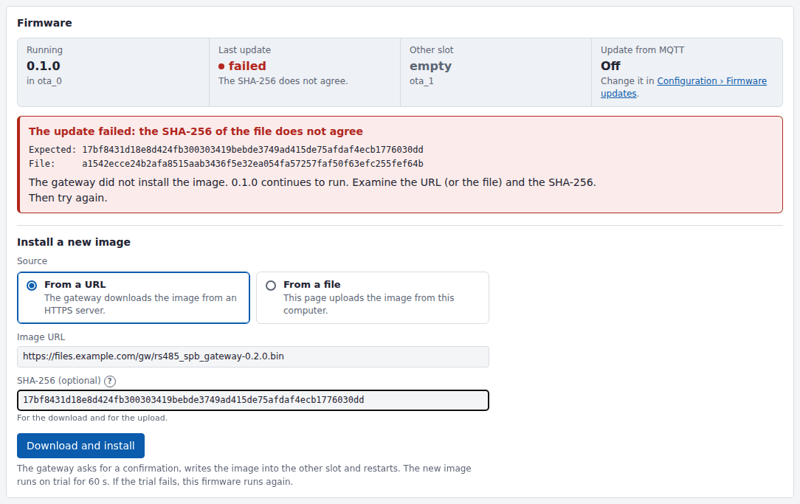

# Update the firmware

This procedure tells how to install a new firmware image on a gateway through the network, how to make sure that the update is complete, and how to go back to the earlier image.

- For the full process, the trial and the rollback, refer to [`idf/README.md` §3.6](../../idf/README.md#36-firmware-updates-fw-1).
- The owner of the board can always flash it over USB as well. The project burns no eFuses (#133).

> **Warning: Do not use this document as verified data for the board.** The firmware has never run on the board (#1, #18). The E2E tests the updates, the trial and the rollback in QEMU. The images come from the firmware in QEMU.

## Before you start

You need:

- The new image `rs485_spb_gateway.bin`. Build it with `idf.py build` in `idf/`. The file is in `idf/build/`.
- Access to the web UI, with the web password. An update from the web UI is always possible.
- For a download: a web server with HTTPS that the gateway can reach. The gateway needs a valid clock to examine the certificate of the server.
- As an option, the SHA-256 of the image file, for example from `sha256sum rs485_spb_gateway.bin` or from the release page.

> **Caution: Update one pilot gateway first.** An image that passes its self-check but cannot connect to the broker of a site stays installed. Then a person must go back to the earlier image in the web UI.

## How an update operates

1. The gateway writes the new image into the other slot of the flash. The running image continues to operate.
2. Before it writes past the header, the gateway does a pre-flight check. It refuses an image of another project, or an image that cannot read the stored configuration, the NVS or the LittleFS partition.
3. If you gave a SHA-256, the gateway calculates the SHA-256 of the file that it wrote. When the two values do not agree, the gateway stops the update.
4. At the end, the gateway verifies the image (checksum and SHA-256 of the image), sends the NDEATH, and restarts into the new image.
5. The new image runs on trial. It must operate for 60 s in the expected mode. Then it confirms itself.
6. If the trial fails, or if a reset occurs during the trial, the gateway goes back to the earlier image.

During the trial (approximately 60 s), the gateway refuses a configuration save and a new update (HTTP 409). The trial has no button: the new image confirms itself.

The SHA-256 is a check of the file, not a signature. It finds a damaged or wrong file before the gateway installs it.

## Install an image from the computer

1. Open the web UI. Stay on the tab **Status**.
2. In the card **Firmware**, below **Install a new image**, click **From a file**.
3. Click **Choose a file**, and select `rs485_spb_gateway.bin`. The choice does not start the upload.
4. Optional: in **SHA-256 (optional)**, type or paste the SHA-256 of the file.
5. Click **Upload and install**.
6. In the confirmation "Install rs485_spb_gateway.bin?", click **Upload and install**. To stop, click **Cancel**.
7. Keep the page open until the end of the upload. The card shows the progress of the upload.
8. Wait for the message "Image installed: restarting into the new version."
9. Wait approximately 30 s. Then load the page again.
10. Do the steps of "Make sure that the update is complete".

   

If the pre-flight check refuses the image, a red box shows in the card. Refer to [If the gateway refuses the image](#if-the-gateway-refuses-the-image).

## Install an image from a web server

1. Put the image on the web server.
2. In the card **Firmware**, below **Install a new image**, click **From a URL**.
3. In **Image URL**, type the URL of the image (`https://…`, 255 characters at most).
4. Optional: in **SHA-256 (optional)**, type or paste the SHA-256 of the file.
5. Click **Download and install**.
6. In the confirmation "Download and install the image?", click **Download and install**.
7. Read the progress in the card. You can close the page. At the end, the gateway restarts.
8. Do the steps of "Make sure that the update is complete".

The gateway examines the certificate of the server with `ota.ca_file`. If that key is not set, it uses `mqtt.tls.ca_file` when TLS is on (`mqtt.tls.enabled`). Otherwise, it uses the public CA bundle of ESP-IDF. To set `ota.ca_file`, refer to [Set the CA of the image server](#set-the-ca-of-the-image-server).

The field **SHA-256 (optional)** accepts 64 hexadecimal characters. The page changes capital letters to small letters. A space or another length is an error: the page shows it below the field, and it starts no download and no upload.

## Set the CA of the image server

Do this procedure when a private CA signed the certificate of the image server, and the CA file of the MQTT card does not contain that CA.

1. Open the tab **Configuration**.
2. In the card **Firmware updates**, click **Load a file…** below **CA file of the image server**.
3. Select the PEM file of the CA. The field then shows the new file, with the subject and the last day of its certificate.
4. Click **Save and restart**.

To use a file that is already in the gateway, select it in the field. The empty option of the field names the CA that the gateway uses without the key: the CA file of the MQTT card when TLS is on, else the public root CAs. For the key, refer to [`ota`](../reference/configuration.md#ota).

## Let a Sparkplug host start an update

By default, a Sparkplug host cannot start an update (`ota.mqtt` is `false`). The NBIRTH then does not contain `Node Control/Firmware Update`, `Node Control/Firmware SHA-256` and `Node Control/Boot Other Slot`. The gateway refuses an NCMD that writes them.

> **Caution: Turn on Update from MQTT only when the ACL of the broker lets only your Sparkplug host publish to the NCMD topic of the gateway.** Each client that can publish to `spBv1.0/<group_id>/NCMD/<edge_node_id>` can then change the firmware.

1. Open the tab **Configuration**.
2. In the card **Firmware updates**, select **Update from MQTT**.
3. Click **Save and restart**.
4. After the restart, make sure that the card **Firmware** of the tab **Status** shows **Update from MQTT: On**.

The host then sends the NCMD `Node Control/Firmware Update` with the URL as a String. As an option, it sends `Node Control/Firmware SHA-256` with the SHA-256 of the file, in the same NCMD or in an earlier one. The host reads the result in `Firmware Update/State` and `Firmware Update/Progress`. The host can also send `Node Control/Boot Other Slot` (Boolean `true`). The gateway then restarts into the image of the other slot, as the button **Restart into `<version>`** does. For the metrics, refer to [Sparkplug messages and metrics](../reference/sparkplug-messages-and-metrics.md).

## Make sure that the update is complete

1. Wait 60 s after the restart.
2. In the card **Firmware**, make sure that **Last update** is `installed <version>`.
3. Make sure that the card **Network and MQTT** shows the broker as connected.
4. Make sure that the card **Modbus devices** shows each device online.

| State | Meaning |
|---|---|
| `downloading <version>` | The transfer is in progress |
| `restarting into <version>` | The gateway restarts into the new image |
| `testing <version>` | The new image is on trial. Wait |
| `installed <version>` | The new image confirmed itself. The update is complete |
| `failed: <cause>` | The update did not occur. The earlier image runs. Read the cause |
| `failed: image <version>: the SHA-256 of the file does not agree` | The file is not the file of the SHA-256. The card shows the two values. Examine the file (or the URL) and the SHA-256. Then try again |
| `rolled back from <version>: <cause>` | The new image failed its trial. The earlier image runs again. The summary of the card shows it |

## Go back to the earlier image

Do this when the new image operates but does not do what you need, for example when it cannot connect to the broker of the site.

1. In the card **Firmware**, below **Actions with a restart**, click **Restart into `<version>`**. The button shows the version in the other slot.
2. In the confirmation, click **Restart into `<version>`** again.
3. Wait for the restart and the trial (60 s).
4. Make sure that the card shows the earlier version.

The button is not available during the trial of a new image. After the trial, the button is the rollback. The button does not depend on **Update from MQTT**.

You can also upload the earlier image. The earlier image possibly cannot read a configuration that you saved after the update. Then the gateway restores the configuration from before the update. It does this only if the configuration did not change after the first save with the new image. Else it refuses the image and gives the changed paths.

## If the gateway refuses the image

| Message | What to do |
|---|---|
| `the configuration needs schema N, the image reads M: <paths>` | The image is older than the stored configuration. Remove the keys at these paths, or use force (below) |
| NVS format or LittleFS version lower | The image cannot read the stored data. Use a newer image |
| The image is "unknown" | The image is from before the pre-flight check. Use force only if you accept its risks |
| `testing <version>: N s left` | A trial is in progress. Wait, then try again |

The refusal of an upload or a download shows as a red box in the card **Firmware**. The box gives the name of the file, the version of the image and each reason on its own line.

**Force.** Force installs the image even if the pre-flight check refuses it. The new image must then only reach recovery mode. In recovery mode, the gateway does not poll and does not connect to MQTT. Only the network and the web UI operate. Correct the configuration there.

> **Caution: Do not force an image with a lower NVS format or LittleFS version, unless you accept the loss of the data.** Such an image cannot read the NVS or `/cfg`, and it can erase them. Then you lose the secrets and the configuration.

To force an image that the gateway refused:

1. Read the reasons in the red box.
2. Click **Install into recovery mode**.
3. In the confirmation, click **Install into recovery mode** again. The web UI sends the same file or the same URL and SHA-256 again, with force. You do not select the file again.

To keep the running image, click **Cancel** in the red box.

To force the restart into the other slot, do the same steps in the red box. Its button is **Restart into recovery mode**.

In recovery mode after an update, the area **Actions with a restart** also has the button **Restore the configuration from before the update**. Refer to [Recover a gateway](recover-the-gateway.md).

## If the web UI is not available

Flash the image over USB: refer to [`idf/README.md` §3.2](../../idf/README.md#32-firmware). For the other paths, refer to [Recover a gateway](recover-the-gateway.md).
