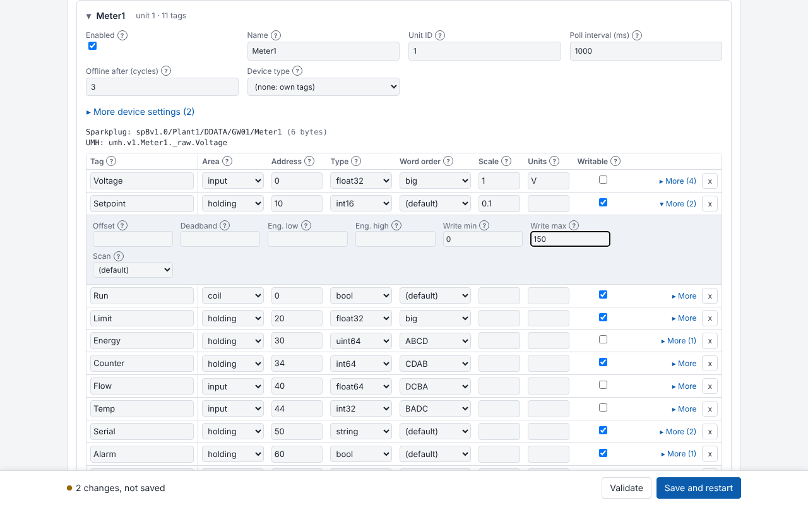
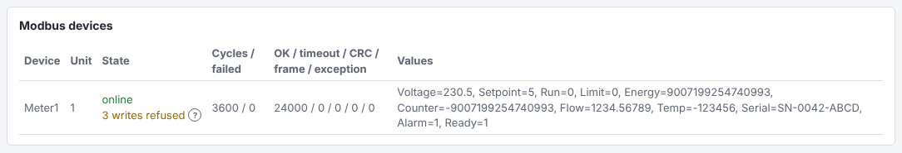

# Write a value to a Modbus device or a digital output

This procedure tells how a Sparkplug host writes a value to a Modbus device (DCMD) or to a digital output of the board (NCMD). The gateway writes the value on the bus, reads it again, and publishes the confirmed value.

- For the commands and the node metrics, refer to [Sparkplug messages and metrics](../reference/sparkplug-messages-and-metrics.md#commands).
- For the limits of the commands on a slow broker, refer to [Known limitations](../reference/known-limitations.md#commands).

> **Warning: Do not use this document as verified data for the board.** The firmware has never run on the board (#1, #18). The RS485 hardware mode and the digital outputs are compile-only. The E2E tests the commands in QEMU, with a Modbus slave and a model of the outputs.

## Before you start

- The tag must be writable: in the tab **Configuration**, card **Devices and tags**, the column **Writable** of the tag is set. Only `coil` and `holding` tags can be writable. Refer to [Add the tags](add-a-modbus-device.md#4-add-the-tags).
- The device must be enabled and online: the host received its DBIRTH. A disabled device has no DBIRTH, and the gateway discards a DCMD for it.
- The host must use the Sparkplug datatype of the DBIRTH. For example, an `int16` tag with the scale 0.1 is a Float in Sparkplug, not an Int16.

## The rules of a command

| Rule | Result if a metric does not obey it |
|---|---|
| The metric has the name or the alias of the DBIRTH | The gateway discards the metric |
| The metric is writable | The gateway discards the metric |
| The datatype is the datatype of the DBIRTH. A metric without a datatype uses the datatype of the DBIRTH | The gateway discards the metric |
| An integer or Boolean tag gets a value without a fraction | The gateway discards the metric |
| The value fits in the register after the inverse scale: `raw = (value − offset) / scale` | The gateway does not write the value |
| The value is in the write limits of the tag (Write min and Write max) | The gateway discards the metric, and adds 1 to the counter of refused writes |

The gateway writes the other metrics of the command. The log gives the reason of each discard. The gateway applies no metric of a command in two cases: it cannot decode the payload, or the queue of the bus has no space for all the writes. A write goes before the polls in the queue of the bus.

The gateway writes one register with FC06 and one coil with FC05. A device with **Write with FC15/FC16** (`write_multiple`) gets FC16 and FC15. A value of two or more registers always goes with FC16.

After the write, the gateway reads the register again, and publishes the value of the device in a DDATA. If this read fails, the gateway publishes the value that the device acknowledged.

## Set the write limits of a tag

Write limits stop a host that sends a value that the device must not get, for example a setpoint of 9999 to a drive that accepts 0 to 100.

1. In the web UI, click the tab **Configuration**.
2. In the card **Devices and tags**, click **More** in the row of the writable tag.
3. Type **Write min**, **Write max**, or the two values. Use the units of the tag, after the scale and the offset. Empty = no limit on that side.
4. Click **Validate**. Then click **Save and restart**.

   

The gateway refuses a DCMD metric with a value out of the limits:

- It does not write to the device.
- It writes a warning to the log, for example `DCMD: metric 'Setpoint' discarded: value 200 out of the write limits [0, 150]`.
- It adds 1 to the counter of refused writes of the device. The shell command `devices` gives `writes refused <n>`, and `GET /api/status` gives `write_refused`.
- The card **Modbus devices** of the Status tab shows the counter in the State cell of the device, below online or offline: "1 write refused" or "<n> writes refused", in amber. A device with 0 refused writes shows nothing. The counter starts at 0 at each start of the gateway.

  

Sparkplug has no answer to a command, so the host sees no error. The next DDATA has the value of the device. The limits do not apply to Modbus TCP requests. For the rules, refer to [Write limits](../reference/configuration.md#write-limits).

## Write a value from a Sparkplug host

1. In the host, find the device `<device_id>` under the edge node `<group_id>/<edge_node_id>`.
2. Select the writable metric, for example `Setpoint`.
3. Write the new value.
4. Make sure that the host shows the new value, from the DDATA of the gateway.

The host publishes a DCMD on `spBv1.0/<group_id>/DCMD/<edge_node_id>/<device_id>`. Ignition (MQTT Engine), UMH Core and other Sparkplug hosts can send it. UMH Core needs a write flow: refer to [Connect the gateway to UMH Core](connect-to-umh-core.md).

## Write a value from a script

This example uses Python, `paho-mqtt` and the Sparkplug protobuf of the repository. It sets `Setpoint` (an `int16` holding register with `"scale": 0.1`, thus a Float) to 12.5, and the coil `Run` to true.

1. Install the packages:

   ```sh
   pip install paho-mqtt protobuf grpcio-tools
   ```

2. Save this script as `dcmd.py`. Set the broker and the names of your gateway:

   ```python
   import sys
   import time

   import paho.mqtt.client as mqtt

   sys.path.insert(0, "idf/tools")       # the repository, for spb_decode.py
   import spb_decode

   BROKER, PORT = "192.168.1.10", 1883
   TOPIC = "spBv1.0/Plant1/DCMD/GW01/Meter1"   # group, edge node, device

   spb = spb_decode.load_module()          # the Eclipse Tahu sparkplug_b.proto
   p = spb.Payload(timestamp=int(time.time() * 1000))
   m = p.metrics.add(name="Setpoint", datatype=9)   # 9 = Float
   m.float_value = 12.5
   m = p.metrics.add(name="Run", datatype=11)       # 11 = Boolean
   m.boolean_value = True

   c = mqtt.Client(mqtt.CallbackAPIVersion.VERSION2, client_id="dcmd-script")
   c.connect(BROKER, PORT)
   c.loop_start()
   c.publish(TOPIC, p.SerializeToString(), qos=0).wait_for_publish()
   c.loop_stop()
   c.disconnect()
   ```

3. Run the script from the root folder of the repository:

   ```sh
   python dcmd.py
   ```

4. Make sure that the web UI shows the new values: tab **Status**, card **Modbus devices**.

For the datatype of each tag, refer to [The datatypes in Sparkplug](../reference/configuration.md#the-datatypes-in-sparkplug). Use `int_value` for Int8 to UInt32, `long_value` for Int64 and UInt64, `double_value` for Double and `string_value` for String.

## Set a digital output

The gateway publishes the outputs as the node metrics `DO/1` to `DO/8` (Boolean). A host sets an output with an NCMD on `spBv1.0/<group_id>/NCMD/<edge_node_id>`, with the metric `DO/<n>` and a Boolean value.

- An output that a local rule controls does not accept the NCMD. Refer to [Local rules](../reference/configuration.md#local-rules).
- Without a Sparkplug session for `local_io.failsafe_s`, the outputs go to their safe state. Refer to [The safe state of the DOs](../reference/configuration.md#the-safe-state-of-the-dos).
- `true` on a pulse DO starts its pulse. The NDATA gives `true`, and then `false` after the pulse. Refer to [Pulse DOs](../reference/configuration.md#pulse-dos).
- Without a host, you can set an output from the Status tab of the web UI. Refer to [Set up the local inputs and outputs](set-up-the-local-io.md#set-a-do-from-the-status-tab).

## Other commands of the node

A host can also send other NCMD metrics, for example `Node Control/Rebirth` and `Node Control/Reboot`. The button **Rebirth** of the card **Network and MQTT** in the Status tab does the same as `Node Control/Rebirth`. For all the NCMD metrics, refer to [NCMD](../reference/sparkplug-messages-and-metrics.md#ncmd).

## If the value does not change

1. Read the log of the gateway (console or syslog). Find the reason of the discard.
2. Make sure that the datatype of the command is the datatype of the DBIRTH.
3. Make sure that the tag is writable, and that the device is enabled and online.
4. Make sure that the value is in the write limits of the tag (Write min, Write max). The log then gives `out of the write limits`.
5. Do a test read of the register. Refer to [Add a Modbus device and its tags](add-a-modbus-device.md), step 2.
6. If the device answers with a Modbus exception, read the data sheet of the device. Some registers are writable only in a special mode of the device.
7. If the device answers with exception 1 (illegal function) to FC06 or FC05, set **Write with FC15/FC16** in the panel **More device settings** of the device.
