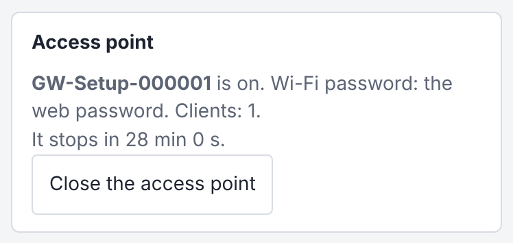

# The access point

This document gives the facts about the commissioning access point of the gateway (issue #187): its key, its times, its signals, its REST API and its shell commands.

- For the procedures, refer to [Set the first web password on site](../how-to/set-the-first-web-password.md) and [Get on the access point on a later visit](../how-to/get-on-the-access-point.md).
- For the reasons and the residual risks, refer to [The security of the access point](../explanation/access-point-security.md).
- For the choices of the implementation, refer to [The secrets in NVS](commissioning-and-secrets.md#the-secrets-in-nvs) and [What only the board can test](commissioning-and-secrets.md#what-only-the-board-can-test).

> **Warning: Do not use this document as verified data for the board.** The firmware has never run on the board (#1, #18). The radio of the access point is compile-only. The QEMU build runs a simulated access point with the same life, key and status, but with no radio. Nobody has examined the PMK as the key of the SoftAP on the board yet (#130 item N9).

## Network and address

| Item | Value |
|---|---|
| Network name (SSID) | `GW-Setup-XXXXXX`. `XXXXXX` is the last 3 bytes of the MAC address of the access point, in hexadecimal |
| Address of the gateway | `192.168.4.1`, the default of ESP-IDF. The subnet is `192.168.4.0/24`. You cannot change it |
| Web UI | `https://192.168.4.1/`. With `web.https` set to `false`: `http://192.168.4.1/`. Plain HTTP redirects to HTTPS, except the requests of the captive portal |
| Captive portal | A guide page over plain HTTP, `http://192.168.4.1/portal`. The phone opens it in its captive portal window. Refer to [The captive portal](#the-captive-portal) (issue #274) |
| Security | WPA2-PSK, or open (no key) during a claim window. No WPA3 |
| Modbus TCP | Always refused through the access point (issue #120) |

The web server starts with the access point, also when `web.enabled` is `false`.

## The captive portal

While the access point runs, the gateway acts as a captive portal for the clients of the access point (issue #274). A phone that connects to the access point then opens its captive portal window by itself. That window shows only a guide page. The page tells you to open the web UI in the browser.

### The DNS server

| Item | Value |
|---|---|
| When it runs | Only while the access point runs. It starts and stops with the access point |
| Interface | Only the interface of the access point. A client of the Ethernet or of the Wi-Fi station gets no answer |
| Clients | Only the hosts of the subnet of the access point (the rule of the claim window) |
| Address that the DHCP server of the access point gives as the DNS server | `192.168.4.1`, the default of ESP-IDF |
| A query of type A, class IN | One A record with the address of the access point, `192.168.4.1`, for each name. TTL 10 s (`GW_CAPTIVE_DNS_TTL_S`) |
| A query of another type (AAAA, HTTPS, PTR, …) or class | An answer with no records (RCODE `NOERROR`). The client then uses the A record |
| No answer | A message that is not a standard query with one valid question. For example: a response, another opcode, or 2 questions. Also a compression pointer in the question, a label of more than 63 bytes, a name of more than 255 bytes, or a message of more than 512 bytes |
| Where it runs | In the `tcpip` task of lwIP, as the receive function of a UDP PCB on port 53. It has no task of its own. Refer to [The architecture of the firmware](architecture.md#tasks-queues-and-ownership) |
| Memory | No buffer of its own. It reads the query in the receive buffer of lwIP, and writes the answer into a send buffer of lwIP |

The answer copies the ID, the question and the RD bit of the query. It sets QR and AA. It does not copy an EDNS option of the query.

The log gives the start and the stop:

- `ap: captive portal: the DNS server answers each A query of a client of the access point with 192.168.4.1`
- `ap: captive portal: DNS server stopped (since boot: N answers, M queries without an answer)`

### The HTTP port

The captive portal uses only the plain HTTP port (`web.port`, default 80). With `web.https` set to `true`, this is the port that redirects to HTTPS. With `web.https` set to `false`, it is the port of the web UI.

| Request | Client of the access point | Other client, or the access point is off |
|---|---|---|
| `GET /portal` | `200` with the guide page | As before #274: a redirect to HTTPS (`301`), or `404` with `web.https` set to `false` |
| `GET` of a probe path: `/generate_204`, `/gen_204` (Android, Chrome), `/hotspot-detect.html`, `/library/test/success.html` (iOS, macOS), `/ncsi.txt`, `/connecttest.txt`, `/redirect` (Windows), `/canonical.html`, `/success.txt` (Firefox), `/check_network_status.txt` (GNOME), `/kindle-wifi/wifistub.html` (Kindle) | `302 Found` to `http://192.168.4.1/portal`, with a short HTML body (iOS needs a body) | As before |
| `GET` with a `Host` that is not the gateway, for example `captive.apple.com` | `302 Found` to `http://192.168.4.1/portal` | As before |
| `GET` with the `Host` of the gateway: `192.168.4.1`, `<hostname>` or `<hostname>.local` | As before: a redirect to HTTPS, or the web UI with `web.https` set to `false` | As before |
| `PUT`, `POST`, `DELETE` | As before | As before |

- The rule for the client is the rule of the claim window. The request came to the address of the access point, from a host of its subnet. Refer to [Commissioning and secrets](commissioning-and-secrets.md#the-claim-window-cfg-8).
- With a `web.port` other than 80, the redirect has the port: `http://192.168.4.1:<port>/portal`.
- The HTTPS port has no captive portal. A phone that sends an HTTPS probe gets the certificate of the gateway, and the phone does not accept it. This is the expected behaviour of a captive portal.

### The guide page

The guide page is plain HTTP. It has no form, no password field and no secret. It sends no request to the API. Its look is the look of the page of the claim window.

| Item | Value |
|---|---|
| Node name | The edge node ID (`sparkplug.edge_node_id`) in normal mode. In recovery, commissioning, safe mode and the fault mode, the host name (`network.hostname`), because the gateway has no valid configuration |
| Address | The address of the web UI on the access point, in a read-only field: `https://192.168.4.1/`. With `web.https` set to `false`: `http://192.168.4.1/`. A port other than the default is in the address |
| mDNS address | Only when mDNS is on (`network.mdns`): `https://<hostname>.local/` |
| Button "Open in the browser" | It copies the address to the clipboard, then opens the address in a new window. When the window cannot open the browser, the page shows a short text: "The address is in the clipboard". The captive network sheet of iOS and macOS cannot open Safari, thus there the button only copies the address |
| Certificate note | "Your browser shows a certificate warning the first time. The gateway uses its own certificate." Only with HTTPS |
| Note of the claim window | Only while the claim window is open. The note tells that the Wi-Fi network is open until you set the web password. It also tells you to set the web password only on the secure page |

With `web.https` set to `false`, the page says "web page" in place of "secure web page".

For the procedure with a phone, refer to [Set the first web password on site](../how-to/set-the-first-web-password.md). For the reasons of the design, refer to [The security of the access point](../explanation/access-point-security.md#why-the-captive-portal-shows-only-a-guide-page).

## When the access point starts

| Event | Modes |
|---|---|
| A push of BOOT for 2 to 10 s, after the end of the boot. The access point starts at the release | All modes |
| The boot | Only the modes without a valid configuration: recovery, commissioning, safe mode and the PSRAM fault mode |

A push of BOOT while the access point runs starts its times again. A push during the boot has no effect and gives no beep.

## The key in each state

| State | Key of the access point |
|---|---|
| No web password | WPA2 with the commissioning password. Only the serial console shows this password: `ap: WPA2 key = commissioning password '…'` |
| Claim window: no web password, after a push of BOOT | Open (no key), from the push of BOOT to the claim. 5 s after the response of the claim, WPA2 with the new web password. At the end of the window without a claim, WPA2 with the commissioning password |
| Web password set | WPA2 with the web password. The gateway keeps only the PMK of the password |
| Web password set, but no PMK in the stored secrets | WPA2 with the commissioning password. This state is a fault of the stored secrets: refer to [A web password without a PMK](#a-web-password-without-a-pmk) |

A change of the key disconnects the clients of the access point.

## The rule of the web password

The web password is also the WPA2 key, thus it obeys the rule of a WPA2 passphrase:

- 8 to 63 characters.
- Each character is printable ASCII, from 0x20 (space) to 0x7E (`~`): the letters A to Z and a to z, the digits, the space and the symbols of a keyboard.
- The same rule applies to `web.password` in the configuration and to `POST /api/claim`.

## A web password without a PMK

The gateway writes the PMK each time that it writes a web password. Thus a web password without a PMK in the stored secrets is a fault. It has one of these causes:

- The gateway could not read the MAC address of the access point when it calculated the PMK. The log then shows `storage: no WPA2 key for the access point: MAC address not readable`.
- A write error or a power cut stopped a change of the web password. The hash and the PMK are different NVS entries (`web_hash` and `ap_pmk`), and the gateway writes them in a sequence.

**The sequence of the writes (#269).** The sequence makes sure that the stored PMK is always the PMK of the stored password:

1. The gateway erases the PMK, when one is stored and the password changes.
2. It writes the hash of the new password. When the document removes the password, it erases the hash.
3. It writes the new PMK, only when a hash is stored.

| Operation | State after a write error or a power cut |
|---|---|
| The first web password | No password, or the new password without a PMK, or the new password with its PMK |
| A change of the web password | The old password with its PMK, or the old password without a PMK, or the new password without a PMK, or the new password with its PMK |
| The removal of the web password | The old password with its PMK, or the old password without a PMK, or no password |

- No state has the PMK of the old password with the new password, or with no password.
- A save that keeps the password (`"********"`) writes none of the two entries.
- The access point uses the PMK only when the hash of a web password is stored (`gw_wpa_key_is_pmk`). A PMK without a web password is not a key.
- The sequence is in `gw_core` (`gw_wpa_store_plan`). The host test `test_wpa` examines a cut after each write.

The gateway has the same behaviour for each web password without a valid PMK (issue #248):

- The key of the access point is the commissioning password. Thus the owner can always use the access point. The serial console shows this password at each start of the access point.
- At each start of the access point, the log shows a warning: `main: access point: a web password is set, but its WPA2 key (PMK) is not in the stored secrets: the key is the commissioning password. Set the web password again to correct this`.
- `key` in the `ap` object of `GET /api/status` is `commissioning_password`. The shell command `apsim key` (QEMU build) shows `no PMK stored`.
- The web password stays valid for the web UI.
- The claim window does not open, because a web password is set.

The gateway cannot calculate the PMK later, because it does not keep the password. Only a new value of `web.password` gives a PMK. The new value can be the same password. A document with `"********"` keeps the stored hash, and gives no PMK. To set the web password again, refer to [Change the web password](../how-to/change-the-web-password.md).

## Times

| Time | Value | Option | Modes |
|---|---|---|---|
| Open period (the claim window) | 10 min after the push of BOOT, or less (see the next rows) | `CONFIG_GW_WEB_CLAIM_WINDOW_MIN` (1 to 30), menu `Gateway: web` | All modes, only when no web password is set |
| Change to WPA2 after the claim | 5 s after the response of `POST /api/claim` | `GW_APLIFE_CLAIM_SECURE_MS` (a constant in `gw_aplife.h`, not a Kconfig option) | All modes |
| Idle time: the stop without a client | 5 min. The time starts when the access point starts and when the last client disconnects | `CONFIG_GW_SOFTAP_IDLE_MIN` (1 to 60), menu `Gateway: commissioning access point` | All modes |
| Maximum time | 30 min after the push of BOOT, also with a client | `CONFIG_GW_SOFTAP_TIMEOUT_MIN` (1 to 1440), menu `Gateway: commissioning access point` | Normal mode only. The other modes have no maximum time |
| Stop on request | Approximately 2 s after the response of `POST /api/ap/stop`. Immediately with the shell `ap stop` | None | All modes |

## Stops

| Stop | Cause | `last_stop` in `/api/status` |
|---|---|---|
| On request | The button "Close the access point" of the web UI, `POST /api/ap/stop` or the shell `ap stop` | `request` |
| No client | The idle time without a client | `idle` |
| Maximum time | The end of the maximum time (normal mode only) | `time` |

- A stop also closes an open claim window, also before the end of its time. The window accepts only the clients of the access point.
- While a client is connected, the idle time does not apply. During a claim window, the access point then stays on until the claim or the end of the window.
- A new push of BOOT for 2 to 10 s starts the access point again.
- A restart stops the access point and closes the claim window.

## LED and buzzer

The status LED and the buzzer give the state of the access point and the result of a push of BOOT. For the patterns and the beeps, refer to [The status signals](status-signals.md):

- The claim window, or an open access point: blue and white, alternately.
- The access point with WPA2: a short cyan flash each 2 s over the pattern of the gateway.
- BOOT held for 2 s, after the end of the boot: 1 beep. Then BOOT released before 10 s: 1 more beep. During the boot, no beep.
- The claim window set the web password: 1 beep.

## The card "Access point" of the web UI

The Status tab of the web UI has a card "Access point". It shows the network name, the key, the number of clients and the time to the stop. When the access point is on, the card has the button "Close the access point". The button opens a confirmation, and then sends `POST /api/ap/stop`. When `request_via_ap` is `true`, the confirmation also tells that the page stops, because the browser uses the access point.



## The `ap` object of `GET /api/status`

| Key | Type | Value |
|---|---|---|
| `available` | bool | The build has an access point (the radio, or the simulated access point of the QEMU build) |
| `simulated` | bool | The simulated access point of the QEMU build (no radio) |
| `running` | bool | The access point is on |
| `ssid` | text | The network name. It comes from the MAC address, thus it is also known before the first start. `""` only when the gateway cannot read the MAC address |
| `security` | text or `null` | `open` or `wpa2`. `null` when the access point is off |
| `key` | text or `null` | `web_password` or `commissioning_password`. `null` when the access point is off |
| `clients` | integer | The number of clients |
| `left_s` | integer or `null` | The time in seconds to the stop, if no client connects or disconnects. `null` when there is no limit now: a client is connected, and there is no maximum time |
| `open_left_s` | integer | The time in seconds of the open period that is left. 0 when the access point is not open |
| `idle_stop_s` | integer | The idle time in seconds |
| `last_stop` | text | The cause of the last stop: `none` (no stop since the boot), `request`, `idle` or `time` |
| `request_via_ap` | bool | This request came through the access point: the address of the client is in the subnet of the access point (the rule of the claim window). `false` on the Ethernet and on the Wi-Fi station. The QEMU build has no radio: there, it is `true` only after the emulator-only shell command `claimsim … eth` (issue #193) |

Example (normal mode, after a push of BOOT, one client, a request from that client):

```json
"ap": {"available": true, "simulated": false, "running": true, "ssid": "GW-Setup-A1B2C3",
       "security": "wpa2", "key": "web_password", "clients": 1, "left_s": 1680,
       "open_left_s": 0, "idle_stop_s": 300, "last_stop": "none", "request_via_ap": true}
```

## `POST /api/ap/stop`

The request stops the access point. It has the same checks as all the other write requests: HTTP Basic with the web credential, and the CSRF check (the header `X-Requested-With`; `Origin` or `Referer` must be this gateway). The request has no body.

| Status | Body | What it tells |
|---|---|---|
| `202` | `{"ok":true,"stopping":true}` | The access point stops approximately 2 s later. The client gets the response first |
| `401` | | No credential, or a credential that is not correct |
| `403` | | The CSRF check failed |
| `409` | `{"ok":false,"error":"the access point does not run",…}` | The access point is off |
| `429` | | Too many failed logins from this address. The address is blocked for a time |

Example:

```sh
curl -k -u admin:<web password> -X POST -H "X-Requested-With: x" https://192.168.4.1/api/ap/stop
```

## `POST /api/claim`: the items of the access point

A successful claim gives `200` with the object `ap`: `ssid`, `url` (the address of this connection, for example `https://192.168.4.1/`) and `secure_in_s` (5: the seconds to the change to WPA2). `plant` gives the addresses of the gateway on Ethernet and on the Wi-Fi station. `mdns` gives the mDNS name (`null` when mDNS is off). [The REST API](rest-api.md#post-apiclaim) gives the full request and response.

## Shell commands

| Command | Result |
|---|---|
| `status` | The status of the gateway, with one line `ap` (the same line as the command `ap`) |
| `ap` | The state of the access point. For example: `ap       'GW-Setup-A1B2C3' on, WPA2 with the web password, 1 client(s), stops in 1680 s (idle stop 300 s)`, or `ap       off (last stop: on request); a BOOT push of 2-10 s starts it` |
| `ap stop` | Stops the access point immediately. Only with `CONFIG_GW_SHELL_WRITE_COMMANDS` |

The texts of the last stop are `never stopped`, `on request`, `no client` and `end of its maximum time`. During the open period, the line shows `OPEN (no key) for N s more`.

These commands are only in the QEMU build (`CONFIG_GW_IO_SIMULATED`):

| Command | Result |
|---|---|
| `apsim clients <0-10>` | Sets the number of clients of the simulated access point |
| `apsim idle <0-3600>` | Sets the idle time in seconds. 0 sets the Kconfig time again |
| `apsim key` | Shows the start of the SHA-256 of the stored PMK, or `no PMK stored`. It never shows the PMK |
| `claimsim <0-3600> [eth]` | Sets the time of the next claim windows in seconds (0 = the Kconfig time). With `eth`, the emulated Ethernet counts as the access point, for the claim window and for the Modbus TCP gateway |

## Secrets

| Secret | Where | When it changes |
|---|---|---|
| PMK of the web password | NVS, key `ap_pmk`, with the other secrets. 64 hexadecimal characters: PBKDF2-HMAC-SHA1 of the password, with the SSID as the salt, 4096 iterations, 32 bytes | The gateway calculates it only when `web.password` gets a new value: the claim, `PUT /api/config`, `config load`, and a `config.json` with the password in clear text at boot. A document without `web.password` removes it. The factory reset erases it |
| Commissioning password | NVS. 12 random characters | At the first boot and after a factory reset |

The NVS of the board is not encrypted (#133).
