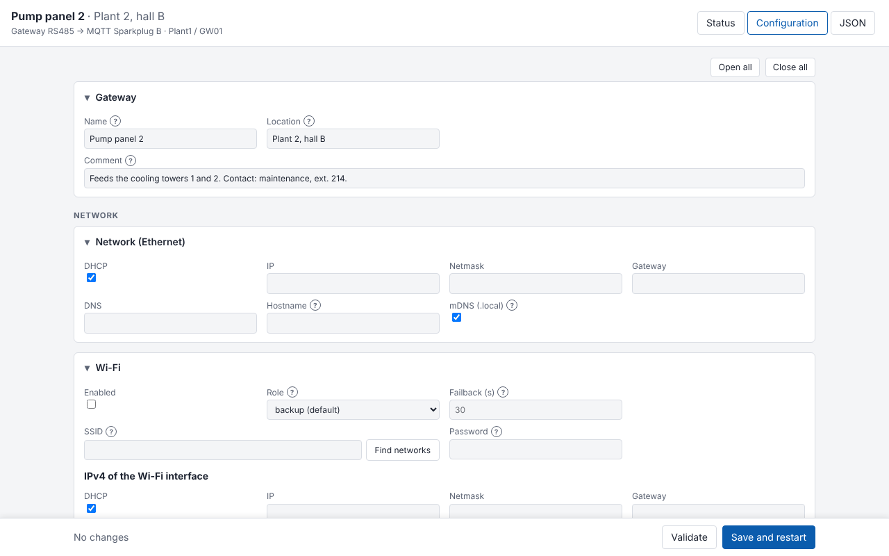
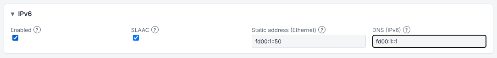
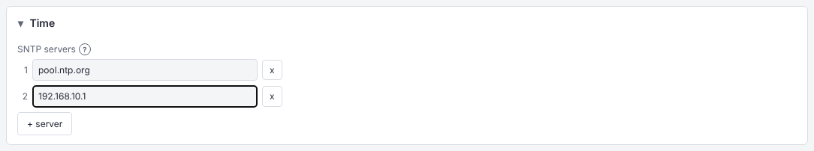
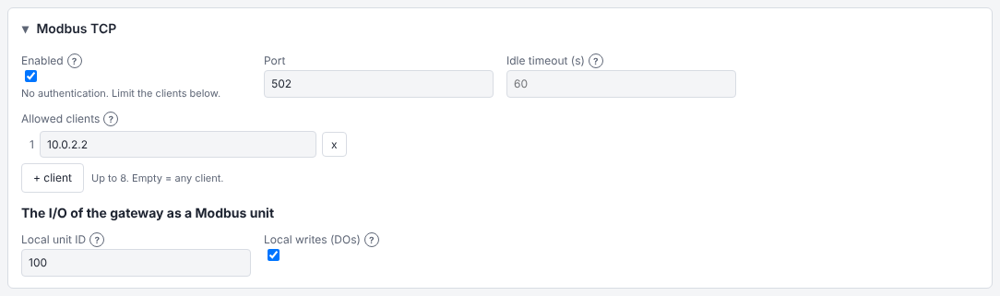
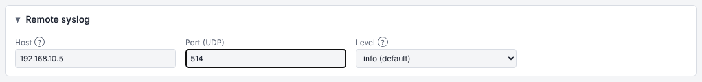

# The configuration document

This document lists all the keys of the configuration document of the gateway, with their types, defaults and rules.

- For the procedures that change the configuration, refer to [Change, back up and restore the configuration](../how-to/change-the-configuration.md).
- For the devices and the tags, refer also to [Add a Modbus device and its tags](../how-to/add-a-modbus-device.md).

> **Warning: Do not use this document as verified data for the board.** The firmware has never run on the board (#1, #18). The parser and the validation have host tests, and the E2E tests the keys in QEMU.

## The document

The configuration is one JSON document. The gateway keeps it in the LittleFS partition (`storage`) as `/cfg/config.json`. Without this file, the gateway uses the configuration in the firmware. For the conditions of that rule, refer to [Load and recovery mode](#load-and-recovery-mode).

- The firmware embeds [`default_config.json`](https://github.com/tmijail/mqtt-rs485-gateway/blob/main/idf/components/gw_storage/default_config.json) as an example.
- To flash a different document, copy it to `idf/fs/config.json`. `idf.py flash` writes the folder `idf/fs/` into the `storage` partition.
- To change the document without a new flash, use the web UI, `PUT /api/config` or the shell command `config load`. Refer to [Change, back up and restore the configuration](../how-to/change-the-configuration.md).

This example has the usual keys:

```json
{
  "network": { "dhcp": true, "ip": "192.168.1.50", "netmask": "255.255.255.0",
               "gateway": "192.168.1.1", "dns": "192.168.1.1" },
  "ntp":     { "servers": ["pool.ntp.org"] },
  "mqtt":    { "host": "192.168.1.10", "port": 1883, "client_id": "",
               "username": "", "password": "", "keepalive_s": 30 },
  "sparkplug": { "group_id": "Plant1", "edge_node_id": "GW01", "primary_host_id": "" },
  "rs485":   { "baud": 9600, "parity": "none", "stop_bits": 1,
               "response_timeout_ms": 200, "retries": 2, "inter_frame_delay_ms": 5 },
  "local_io": { "counter_save_s": 600 },
  "devices": [
    {
      "name": "Meter1", "unit_id": 1, "poll_ms": 1000, "offline_after": 3,
      "tags": [
        { "name": "Voltage", "area": "input",   "address": 0, "type": "float32",
          "word_order": "big", "scale": 1.0, "offset": 0.0, "deadband": 0.1,
          "writable": false, "units": "V" },
        { "name": "Setpoint", "area": "holding", "address": 10, "type": "int16",
          "scale": 0.1, "writable": true },
        { "name": "Run",      "area": "coil",    "address": 0, "type": "bool",
          "writable": true }
      ]
    }
  ]
}
```

The top-level sections are `gateway`, `network`, `ntp`, `mqtt`, `sparkplug`, `rs485`, `local_io`, `device_types`, `devices`, `syslog`, `web`, `modbus_tcp` and `ota`. The sections `mqtt` and `sparkplug` are necessary. The other sections are optional.

## General rules

- An unknown key is an error. A duplicate key is an error.
- The maximum size of the document is 128 KiB.
- A maximum of 16 devices, 64 tags for each device, and 256 tags in total. A device with a device type counts the tags of its type.
- An error gives the JSON path of the value, for example `devices[1].tags[2].type`. A JSON syntax error gives the line and the column.
- A warning does not stop a save. The warnings are the name checks of [UMH names](#name-checks-for-umh-core).
- These rules are the configuration schema of `docs/SPEC.md` §6.
- The Configuration tab of the web UI has a control for each key. This document gives the card of each section.
- A list of values in the web UI shows the default value of an optional key with the text "(default)", for example **3.1.1 (default)**. When the key is not in the document, the list shows its default value. A save then does not add the key, if you keep the default value. When you select a different value, the web UI writes it. When the key is in the document, the web UI writes the selected value, also the default value. A checkbox of an optional key has the same rule. The JSON tab and `PUT /api/config` keep each key as you write it.

**Removed keys.** The gateway refuses these keys as unknown keys. A stored document with one of them puts the gateway in recovery mode. There is no migration before v1.0: change the document, then save it again.

| Removed key | Use now | Issue |
|---|---|---|
| `ntp.server` | `ntp.servers` | #201 |
| `devices[].tags[].bit` | `bit_offset` | #202 |
| `local_io.di_debounce_ms` | `local_io.di[].debounce_ms` | #211 |
| `ota.enabled` | `ota.mqtt`. An update from the web UI is always possible | #223 |
| The tags of each device of one model, with `devices[].type` as a free text | `device_types`, and `devices[].type` as the name of a device type. A device with `type` and `tags` is an error at `devices[i].tags` | #213 |

### The rules of the names

These rules apply to `group_id`, `edge_node_id`, `primary_host_id`, `device_prefix`, the device `name`, the `name` of a device type, and the tag `name` and `units`:

- The names are valid UTF-8 (RFC 3629: no overlong form, no surrogate) (#162).
- The Sparkplug IDs do not contain `/`, `+`, `#` or control characters (U+0000 to U+001F and U+007F to U+009F). A broker can close the connection for a topic with a control character.
- Two device names must not differ only in case. Two device types, or two tag names of one device or of one device type, must not differ only in case. The comparison folds the ASCII letters only: `É` and `é` are two different names for the check. The specification says SHOULD NOT (`tck-id-case-sensitivity-sparkplug-ids`, `tck-id-case-sensitivity-metric-names`), and the gateway rejects the configuration.
- A tag name must not also be a folder of another tag name of the same device or device type, for example `A` and `A/B`.
- The name of a device type must not be the name or the first folder of a node metric: `bdSeq`, `DI`, `DO`, `Counter`, `Node Control`, `Node Info`, `Firmware Update` or `Run Hours`.
- The longest device topic, `spBv1.0/<group_id>/DBIRTH/<edge_node_id>/<device_id>`, must fit in 159 bytes.

### The configuration schema

Each key has a schema number. A firmware image declares the highest schema that it reads. Before an update, the gateway refuses an image that cannot read the stored document. For this check, refer to [Update the firmware](../how-to/update-the-firmware.md).

The firmware of this version reads schema 2. These keys are schema 2. All the other keys and values are schema 1.

| Section | Keys of schema 2 |
|---|---|
| `gateway` | The section, and `name`, `location` and `comment` |
| `ntp` | `servers` |
| `local_io` | `di` (with `invert` and `debounce_ms`), `do_pulse_ms`, `fast_counters` (with `di` and `glitch_ns`) and `run_hours` |
| `modbus_tcp` | `local_unit_id` and `local_writes` |
| `ota` | `mqtt` |
| `device_types` | The section, and `name`, `tags`, and `bit_offset` and `bit_width` of its tags |
| `devices[]` | `enabled`, `write_multiple` and `type` (the name of a device type) |
| `devices[].tags[]` | `write_min`, `write_max`, `bit_offset` and `bit_width` |

### The secrets

The gateway keeps `mqtt.password`, `network.wifi.password` and `web.password` in NVS, not in the document.

| Value in a document that you load | Result |
|---|---|
| `"********"` | The gateway keeps the stored secret |
| A new text | The gateway replaces the secret |
| `""` | The gateway deletes the secret |
| The key is not in the document | The gateway deletes the secret: the document replaces the full configuration |

- An export shows each secret that has a value as `"********"`.
- In the file `/cfg/config.json`, a secret that is not there, empty or `"********"` gets its value from NVS.
- A secret in clear text in the file is valid. The gateway moves it to NVS and writes the file again without it.
- The gateway keeps `web.password` only as a salted PBKDF2-HMAC-SHA256 hash, and as the PMK of the access point. For the reasons, refer to [The security of the access point](../explanation/access-point-security.md).
- For where the gateway keeps the secrets, refer to [Commissioning and secrets](commissioning-and-secrets.md#the-secrets-in-nvs).

## Load and recovery mode

**The firmware uses the embedded configuration only when `/cfg/config.json` does not exist**, and no factory reset occurred or is pending. After a factory reset, the gateway starts in commissioning mode. Refer to [Commissioning and secrets](commissioning-and-secrets.md#the-modes).

All other problems put the gateway in **recovery mode**:

- the LittleFS partition does not mount;
- the file is empty, cannot be read or is larger than the limit;
- the document is not valid;
- a factory reset is not complete, and the boot could not complete it (refer to [Commissioning and secrets](commissioning-and-secrets.md#the-sequence-of-the-factory-reset)).

In recovery mode, **the polling and MQTT do not start**. The network, the web UI, the shell and the access point start. Thus you can correct the configuration without a new flash.

- The network uses the network of the last valid configuration (`lkg_net` in NVS), or DHCP on Ethernet. If that network is not usable, for example a static IP of a different plant, use the access point or the shell.
- The LED blinks red. Each 10 s, the log gives the cause again with the level ERROR.
- A gateway flashed without the `storage` partition does not mount LittleFS, thus it starts in recovery mode. This is intentional: the gateway must never start with the Sparkplug identity of the example.

Examples of the cause in the log:

- `/cfg/config.json: 140000 bytes; the maximum is 131072 (CONFIG_GW_CONFIG_MAX_BYTES)`
- `LittleFS partition 'storage' not mountable (ESP_FAIL)`
- `devices[0].tags[1].writable: only the coil and holding areas are writable`
- `devices[0].tags[0].scal: unknown key`
- `JSON syntax error at line 5, column 3: invalid syntax`

The firmware counts the line and the column in characters, from the error pointer of cJSON. It rejects content after the end of the document. It also rejects a duplicate key in all objects (`mqtt.host: duplicate key`): cJSON accepts duplicate keys, and its searches see only the first one.

For the procedure, refer to [Recover a gateway](../how-to/recover-the-gateway.md#the-configuration-is-rejected).

### The size limit and the memory

- The maximum size of the file is 128 KiB (`CONFIG_GW_CONFIG_MAX_BYTES`, menu `Gateway: storage`).
- The largest document of the schema (16 devices, 256 tags with all their keys) is approximately 46 KB in compact JSON, and 82 KB with an indent of 2 spaces.
- At boot, the firmware allocates the file buffer and the cJSON tree in PSRAM: approximately 200 KB for 256 tags. It releases them before it starts the tasks.
- The log gives the free heap before the parse: `/cfg/config.json: N bytes; free heap: internal … (largest block …), PSRAM …`.
- With PSRAM (the board), the only limit is `CONFIG_GW_CONFIG_MAX_BYTES`.
- The QEMU build without PSRAM (`CONFIG_GW_EMU_NO_PSRAM`) parses in the internal heap. There, a file of approximately 110 KB or less loads. A larger file gives `not enough memory to parse … bytes of JSON`.

### Save and export

- The web UI, `PUT /api/config` and the shell command `config load` use the same validation.
- The firmware saves the document atomically: a temporary file, `fsync`, then `rename`. Then the gateway does an orderly restart (NDEATH).
- `config show` and `GET /api/config` export the document with the secrets masked.
- During the trial of a new firmware image, the gateway refuses a save (HTTP 409). Refer to [Firmware updates](firmware-updates.md#the-trial-of-a-new-image).

## `gateway`

A name, a location and a comment for the people who use the gateway. The card **Gateway** at the top of the Configuration tab has the three fields.

```json
"gateway": { "name": "Pump panel 2", "location": "Plant 2, hall B",
             "comment": "Feeds the cooling towers 1 and 2. Contact: maintenance, ext. 214." }
```

| Key | Type | Default | Rule |
|---|---|---|---|
| `name` | text | `""` | 0 to 63 bytes of valid UTF-8, without control characters |
| `location` | text | `""` | 0 to 63 bytes of valid UTF-8, without control characters |
| `comment` | text | `""` | 0 to 255 bytes of valid UTF-8 |

- With a name, the header of the web UI shows the name and the location, and the name of the product and the edge node ID go to a second line. The title of the browser tab is `name · location`. Without a name, the header and the title do not change.
- `GET /api/status` gives `gateway.name` and `gateway.location`. The NBIRTH gives them as `Node Info/Name` and `Node Info/Location`, only when they are set. Refer to [Sparkplug messages and metrics](sparkplug-messages-and-metrics.md#node-metrics).
- The comment is only in the document and in the Configuration tab. The Status tab, `GET /api/status` and the NBIRTH do not give it.
- The name and the location do not change the Sparkplug IDs or the topics. They are not `sparkplug.device_prefix`.



## `network`

The IPv4 keys of `network` are the keys of Ethernet. In the web UI, they are in the card **Network (Ethernet)**.

An IPv4 address in the configuration is four decimal numbers from 0 to 255 with dots between them (`a.b.c.d`), as `inet_pton` reads it. A number has no leading zero, no sign and no space: the gateway rejects `010.0.0.1`, because other programs read `010` as an octal number (8). The same rule applies to the IPv4 part of an IPv6 address (`::ffff:192.0.2.1`) and to the prefix of `modbus_tcp.allowed_clients` (#226).

The web UI corrects an IPv4 value with leading zeros, because a leading zero usually comes from a notation with zeros for the full width, and that notation is decimal:

- When an IPv4 field of the Configuration tab loses the focus, the web UI removes the spaces before and after the value.
- When the full value is `a.b.c.d`, each number has 1 to 3 digits, and the web UI also removes the leading zeros of each number. In `modbus_tcp.allowed_clients`, the value can also be `a.b.c.d/n`, and the web UI removes the leading zeros of `n` too. Thus `192.168.001.010` becomes `192.168.1.10`, and `010.000.000.001/08` becomes `10.0.0.1/8`.
- The web UI does not change the value while you type. The changed value counts as a change in the bar at the bottom of the page.
- The web UI does not change other values: a name, an IPv6 address, a sign (`+1.2.3.4`) or a number above 255. The validation gives the error at the field.
- The IPv4 fields are `ip`, `netmask`, `gateway` and `dns` of `network` and of `network.wifi`, `mqtt.host`, the `host` of each item of `mqtt.backup_brokers`, `ntp.servers`, `syslog.host` and `modbus_tcp.allowed_clients`.
- The JSON tab, `PUT /api/config` and the shell command `config load` do not change a value. They give the error.

| Key | Type | Default | Rule |
|---|---|---|---|
| `dhcp` | bool | `true` | With `false`, `ip`, `netmask` and `gateway` are necessary |
| `ip`, `netmask`, `gateway` | text | — | IPv4 addresses |
| `dns` | text | — | An IPv4 DNS server |
| `hostname` | text | `""` | One DNS label: 1 to 63 letters, digits and `-` (not at the start or the end), no dots. Empty = a name from `edge_node_id`: lower case, and one `-` for each group of characters that are not letters or digits (`GW01` → `gw01`). The DHCP requests contain the hostname |
| `mdns` | bool | `true` | The gateway answers `<hostname>.local` with mDNS. It announces the web UI as the service `_https._tcp` on `web.https_port`, or `_http._tcp` on `web.port` with `web.https: false`. The instance name is `<group_id>/<edge_node_id>` |
| `wifi` | object | — | Refer to [`network.wifi`](#networkwifi) |
| `ipv6` | object | — | Refer to [`network.ipv6`](#networkipv6) |

### `network.wifi`

Wi-Fi station, as an alternative interface or as a backup interface for Ethernet. In the web UI, the keys are in the card **Wi-Fi**. For the procedure, refer to [Connect the gateway to a Wi-Fi network](../how-to/connect-the-gateway-to-wi-fi.md).

```json
"network": { "dhcp": true,
             "wifi": { "enabled": true, "ssid": "Plant", "password": "secret123",
                       "role": "backup", "failback_s": 30, "dhcp": true } }
```

| Key | Type | Default | Rule |
|---|---|---|---|
| `enabled` | bool | `false` | `false` = Ethernet only |
| `ssid` | text | `""` | 1 to 32 bytes. Necessary with `enabled: true` |
| `password` | text (secret) | `""` | Empty (open network), 8 to 63 characters (WPA2), or 64 hexadecimal digits (PSK) |
| `role` | `backup` or `primary` | `backup` | `backup`: Ethernet gets the default route, and the gateway uses Wi-Fi only without Ethernet. `primary`: the opposite |
| `failback_s` | integer | `30` | 0 to 3600. The time that the preferred interface must be up without a cut before it gets the session again |
| `dhcp`, `ip`, `netmask`, `gateway`, `dns` | as in `network` | DHCP | The IPv4 data of the Wi-Fi interface. With `dhcp: false`, `ip`, `netmask` and `gateway` are necessary |

**No path to the broker.** An interface can have a link and an address, but no path to the broker. When all the brokers of the list fail on the active interface, that interface has "no service":

- The session moves at once to the other interface, if it is usable.
- The wait starts at 60 s. Each new failure in sequence makes it two times longer, up to 30 min.
- At the end of the wait, the preferred interface gets the session again.
- The gateway uses an interface with no service when no other interface is usable.

### `network.ipv6`

IPv6 together with IPv4. In the web UI, the keys are in the card **IPv6**.



```json
"network": { "dhcp": true,
             "ipv6": { "enabled": true, "slaac": true, "address": "fd00:1::50", "dns": "" } }
```

| Key | Type | Default | Rule |
|---|---|---|---|
| `enabled` | bool | `false` | `false` = IPv4 only. With `true`, each interface has a link-local address |
| `slaac` | bool | `true` | Stateless address autoconfiguration from the router advertisements |
| `address` | text | `""` | A static address for Ethernet (RFC 4291). The prefix on the link is /64. Multicast, link-local, `::` and `::1` are not permitted |
| `dns` | text | `""` | An IPv6 DNS server. DHCPv4 fills the first two positions, and this server is the third |

The gateway learns the default IPv6 router from the router advertisements. There is no static IPv6 gateway. `mqtt.host`, `ntp.servers` and `syslog.host` accept IPv6 addresses and names with an AAAA record.

## `ntp`

```json
"ntp": { "servers": ["pool.ntp.org", "192.168.10.1"] }
```

| Key | Type | Default | Rule |
|---|---|---|---|
| `servers` | array of texts | `["pool.ntp.org"]` | 1 to 3 names, IPv4 or IPv6 addresses of SNTP servers, 1 to 127 bytes each. An empty item is an error |

- The gateway asks server 1 first. When a server does not answer in 15 s, the gateway asks the next server. After the last server, it asks the first server again.
- Thus a first server that does not answer delays the first valid time by approximately 15 s. The log gives the wait: `edge: clock valid (source sntp) after a wait of 16 s: connecting`.

In the web UI, the card **Time** has one row for each server. An empty row is an error at its field.



Without a valid clock, the gateway opens no MQTT session. Refer to [The clock and the RTC battery](clock-and-rtc-battery.md).

For the procedure, refer to [Set the time servers](../how-to/set-the-time-servers.md).

## `mqtt`

In the web UI, the keys are in the card **MQTT**. The field **Broker** is `host`, and **User** is `username`.

| Key | Type | Default | Rule |
|---|---|---|---|
| `host` | text | — | Necessary. The name, IPv4 or IPv6 address of the primary broker, 1 to 127 bytes |
| `port` | integer | `1883` (`8883` with TLS) | 1 to 65535 |
| `client_id` | text | `""` | 0 to 64 bytes. Empty = `edge_node_id` |
| `username` | text | `""` | 0 to 64 bytes |
| `password` | text (secret) | `""` | 0 to 64 bytes |
| `keepalive_s` | integer | `30` | 5 to 3600 |
| `protocol` | `"3.1.1"` or `"5"` | `"3.1.1"` | The MQTT version for all the brokers of the list |
| `tls` | object | — | Refer to [`mqtt.tls`](#mqtttls) |
| `backup_brokers`, `failover_after`, `primary_return_s` | | | Refer to [The list of brokers](#the-list-of-brokers) |

Each CONNECT has Clean Session = 1. With `protocol: "5"`, each CONNECT has Clean Start = 1, Session Expiry Interval = 0 and Will Delay Interval = 0. Each DISCONNECT of the gateway has the reason code 0x04 (Disconnect with Will Message). The topics, the QoS, the retain flags and the payloads do not change. The gateway connects again with an exponential backoff and jitter (1 s to 60 s).

### `mqtt.tls`

In the web UI, the keys are in the section **TLS** of the card **MQTT**: **Encrypt (TLS)**, **CA file**, **Server name**, **Client certificate** and **Client key**.

```json
"mqtt": { "host": "broker.plant.local", "port": 8883,
          "tls": { "enabled": true, "ca_file": "ca.pem", "server_name": "",
                   "cert_file": "gw01.crt", "key_file": "gw01.key" } }
```

| Key | Type | Default | Rule |
|---|---|---|---|
| `enabled` | bool | `false` | `false` = TCP without encryption. With `true`, the default of `mqtt.port` is `8883` |
| `ca_file` | text | `""` | A PEM file with the CAs that sign the certificate of the broker, in the LittleFS partition (`/cfg/<name>`). Empty = the public root CAs of ESP-IDF |
| `server_name` | text | `""` | 0 to 127 bytes. The name that the certificate of the broker must contain (SAN or CN). Empty = the `host` of the connection. You cannot disable the name check |
| `cert_file` | text | `""` | The PEM certificate of the client, for mutual TLS, in LittleFS. Empty = no client certificate |
| `key_file` | text | `""` | The PEM private key of the client, **not encrypted** (PKCS#1, SEC1 or PKCS#8). Necessary with `cert_file`, and not permitted without it |

- A file name has 1 to 32 characters `A-Z a-z 0-9 . _ -`, without `/`. It must not start with `.`, and it must not be `config.json`.
- The button **Load a file…** below a file field of the card MQTT puts a file into the LittleFS partition, and the field selects it. The REST API uses `PUT /api/files`. Refer to [Connect to a broker with TLS](../how-to/connect-to-a-broker-with-tls.md) and [The REST API](rest-api.md#the-pem-files).
- The card **Certificates** lists the files, with the keys that use each file. It loads, replaces and removes them at once, without **Save and restart**. A replaced file keeps its name: the gateway uses the new content after the next restart. You cannot remove a file that the saved configuration names. Refer to [Manage the certificates](../how-to/manage-the-certificates.md).
- The gateway keeps 16 PEM files at most, and each file has 16384 bytes at most.
- A save of the configuration examines each file that `ca_file`, `cert_file`, `key_file` and `ota.ca_file` name. Each file must exist and hold certificates. The file of `key_file` must hold an unencrypted private key, and the key must agree with the certificate. Otherwise, the error has the path of the key, for example `mqtt.tls.key_file: the key does not agree with the certificate gw01.crt`.
- The gateway uses TLS 1.2 or 1.3, as the broker selects.
- The gateway examines the validity dates of the certificate. Thus the TLS connection waits for a valid clock.
- The gateway validates the TLS keys also when `enabled` is `false`.

### The list of brokers

In the web UI, the keys are in the section **Backup brokers** of the card **MQTT**: the table of the brokers, **Failover after (attempts)** and **Back to the primary after (s)**. On a phone, each broker is a block with its fields **Host** and **Port**. An empty **Port** shows the port of the primary broker, which the backup broker then uses.


```json
"mqtt": { "host": "broker1.plant.local", "port": 1883,
          "backup_brokers": [ { "host": "broker2.plant.local" },
                              { "host": "10.0.0.20", "port": 1884 } ],
          "failover_after": 3, "primary_return_s": 0 }
```

| Key | Type | Default | Rule |
|---|---|---|---|
| `backup_brokers` | array | `[]` | Up to 3 backup brokers, in order, after `mqtt.host`. Each one has `host` (necessary, 1 to 127 bytes) and `port` (default: `mqtt.port`). All the brokers use the same credentials, `client_id`, keepalive and `tls`. With TLS, the gateway examines the name against the `host` of each broker, or `tls.server_name` |
| `failover_after` | integer | `3` | 1 to 20. The number of failed attempts in sequence on a broker before the gateway goes to the next broker. After the last broker, it goes to the first broker |
| `primary_return_s` | integer | `0` | 0 to 86400. `0` = the gateway stays on a backup broker until it fails. With N > 0, the gateway ends a stable session on a backup broker after N s (NDEATH). Then it tries the primary broker one time. If that attempt fails, it goes to the first backup broker |

These are failed attempts:

- a TCP or TLS connection that fails;
- a CONNACK that refuses the connection;
- a SUBSCRIBE that the broker refuses or does not answer;
- a session that stops before one keepalive (60 s maximum) after the NBIRTH.

A stable session sets the count to zero. Each new broker starts with the minimum backoff. For the primary host and the list of brokers, refer to [Sparkplug messages and metrics](sparkplug-messages-and-metrics.md#the-primary-host-application).

## `sparkplug`

| Key | Type | Default | Rule |
|---|---|---|---|
| `group_id` | text | — | Necessary. 1 to 32 bytes |
| `edge_node_id` | text | — | Necessary. 1 to 32 bytes |
| `primary_host_id` | text | `""` | 0 to 32 bytes. Empty = no primary host. Refer to [The primary host application](sparkplug-messages-and-metrics.md#the-primary-host-application) |
| `device_prefix` | text | `""` | 0 to 96 bytes. Refer to [The device prefix](#the-device-prefix) |
| `naming` | `"sparkplug"` or `"umh"` | `"sparkplug"` | `"umh"` selects the UMH preset. Refer to [Name checks for UMH Core](#name-checks-for-umh-core) |
| `diagnostics_s` | integer | `60` | 0, or 10 to 86400. The period of the NDATA with the node diagnostics, in seconds. 0 = only in the NBIRTH |
| `store_forward` | bool or object | `false` | Refer to [`sparkplug.store_forward`](#sparkplugstore_forward) |

The card **Sparkplug** of the Configuration tab has a control for each key. The control of `diagnostics_s` is **Diagnostics period (s)**.

### The device prefix

```json
"sparkplug": { "group_id": "acme", "edge_node_id": "acme:berlin:packaging:gw01",
               "device_prefix": "acme:berlin:packaging:line3" }
```

- `device_prefix` has location levels with `:` between them. No level is empty: no `:` at the start or the end, and no `::`.
- It has the characters of a Sparkplug ID. The number of levels has no limit, other than the length.
- The `device_id` of each device is `<device_prefix>:<name>`. Without the key, it is the name. The DBIRTH, DDATA, DDEATH and DCMD topics use the `device_id`.
- With a `group_id` and an `edge_node_id` of 32 bytes, the `device_id` can have 78 bytes.
- The metric names do not get the prefix.

For the reasons, refer to [Sparkplug names and the UNS](../explanation/sparkplug-names-and-the-uns.md).

### Name checks for UMH Core

The validation finds the names that UMH Core and other UNS hosts change with no error. Sparkplug permits these names, thus they are warnings. The dry run, the shell `config check`, the boot log and the web UI show them, each with its JSON path.

- The gateway divides `edge_node_id`, `device_prefix` and each device `name` at `:`. Each level must match `[A-Za-z0-9][A-Za-z0-9_-]*`.
- The gateway divides each tag `name` at `/`. Each segment must match `[A-Za-z0-9][A-Za-z0-9._-]*`.
- These items also give a warning:
  - a `primary_host_id` that is not empty;
  - a device `type`;
  - a tag of the type `bytes`.

With `"naming": "umh"`, the name rules become errors. The other warnings stay warnings. The preset also changes some metrics. Refer to [UMH names and topics](umh-names-and-topics.md) and [Sparkplug messages and metrics](sparkplug-messages-and-metrics.md#the-umh-preset).

### `sparkplug.store_forward`

| Key | Type | Default | Rule |
|---|---|---|---|
| `store_forward` | bool or object | `false` | `false`: without a session, the gateway keeps only the last value of each metric. `true`: the gateway keeps each change in a ring buffer, and publishes the changes with `is_historical = true` in the next session |

The object form, with the optional spill to a microSD card:

```json
"sparkplug": { "group_id": "Plant1", "edge_node_id": "GW01",
               "store_forward": { "enabled": true, "sd": { "enabled": false, "max_kb": 131072 } } }
```

| Key | Type | Default | Rule |
|---|---|---|---|
| `enabled` | bool | `true` | The same as `store_forward: true` |
| `sd.enabled` | bool | `false` | Moves the oldest samples to the microSD card when the RAM buffer is three quarters full. It requires `enabled` |
| `sd.max_kb` | integer | `131072` | 64 to 4 194 304 (128 MB by default). The space that the gateway uses on the card |

> **Caution: Read the GPIO45 warning in [Store & forward](store-and-forward.md#the-microsd-card-and-gpio45) before you set `sd.enabled`.** GPIO45 (D0 of the card) is a strapping pin. A pull-up on D0 can stop the boot of the board.

The web UI has the section **Store & forward** in the card **Sparkplug**:

| Control | Key |
|---|---|
| Keep the changes without a session | `store_forward` (`true` or `false`), or `enabled` of the object |
| Spill to the microSD card | `sd.enabled`. The control is disabled while store & forward is off. The GPIO45 caution shows while the spill is on |
| Space on the card (KB) | `sd.max_kb`. The size in MB shows below the field |

The web UI writes `store_forward` as `true` or `false` when `sd.enabled` and `sd.max_kb` have their default values. In the other cases, it writes the object. When the controls do not change, the web UI keeps the form of the document.


For the buffer, the card, the retention and the duplicates, refer to [Store & forward](store-and-forward.md).

## `rs485`

In the web UI, the keys are in the card **RS485**. The field **Timeout (ms)** is `response_timeout_ms`.

| Key | Type | Default | Rule |
|---|---|---|---|
| `baud` | integer | `9600` | 1200 to 115200 |
| `parity` | `none`, `even` or `odd` | `none` | |
| `stop_bits` | integer | `1` | 1 or 2 |
| `response_timeout_ms` | integer | `200` | 10 to 5000 |
| `retries` | integer | `2` | 0 to 5 |
| `inter_frame_delay_ms` | integer | `5` | 0 to 1000. The delay between two transactions |

The UART always uses 8 data bits. The gateway keeps the silence of 3.5 characters between the frames.

## `devices`

An array of up to 16 devices. In the web UI, the devices are in the card **Devices and tags**. For the procedure, refer to [Add a Modbus device and its tags](../how-to/add-a-modbus-device.md).

| Key | Type | Default | Rule |
|---|---|---|---|
| `enabled` | bool | `true` | `false` = the device stays in the configuration, but the gateway does not poll it. Refer to [A disabled device](#a-disabled-device) |
| `name` | text | — | Necessary. 1 to 39 bytes |
| `unit_id` | integer | — | Necessary. 1 to 247 |
| `poll_ms` | integer | `1000` | 50 to 3 600 000 |
| `offline_after` | integer | `3` | 1 to 1000. After this number of failed cycles in sequence, the device is offline (DDEATH). The first cycle that reads all the blocks makes it online again (DBIRTH) |
| `slow_poll_ms` | integer | 10 × `poll_ms` (maximum 3 600 000) | 50 to 3 600 000, and not less than `poll_ms`. The poll interval of the tags with `scan: "slow"` |
| `block_reads` | bool | `true` | `false` = one request for each tag. Use it for a slave that answers with an exception if a block contains registers that it does not map |
| `max_gap` | integer | `0` | 0 to 1999. The number of unused registers or bits that a block can include to join two tags of the same area. Not permitted with `block_reads: false` |
| `write_multiple` | bool | `false` | `true` = the gateway writes one register with FC16 and one coil with FC15, in place of FC06 and FC05. Use it for a slave that does not accept FC06 or FC05. A write of two or more registers always uses FC16 |
| `type` | text | — | The `name` of an entry of `device_types`. The device then uses the tags of that type. Refer to [`device_types`](#device_types) |
| `tags` | array | — | 1 to 64 tags. Necessary without `type`. Not permitted with `type` |

The defaults of `block_reads`, `max_gap` and `write_multiple` come from the build options `CONFIG_GW_MB_BLOCK_READS`, `CONFIG_GW_MB_BLOCK_MAX_GAP` and `CONFIG_GW_MB_FORCE_MULTI_WRITE`. A block never has more than 125 registers or 2000 bits.

In the web UI, `slow_poll_ms`, `block_reads`, `max_gap` and `write_multiple` are in the panel **More device settings** of each device: **Slow poll interval (ms)**, **Block reads**, **Max gap** and **Write with FC15/FC16**.

### A disabled device

```json
{ "name": "Meter2", "unit_id": 3, "enabled": false, "tags": [ … ] }
```

- The gateway sends no request to a disabled device. The device uses no time of the bus.
- The device has no DBIRTH, no DDATA and no DDEATH. The gateway discards a DCMD for it.
- The validation examines a disabled device as any other device. Its name, its tags and the device limits count.
- A disabled device does not count as offline: it does not set the Modbus fault of the LED or the buzzer alarm `device_offline`.
- The Status tab of the web UI and the shell command `devices` show the state `disabled`. In `GET /api/status`, the device has `"enabled":false`.
- Modbus TCP requests to its unit still go to the bus.

Use it, for example, for a slave that is not connected yet during the commissioning.

### Fast and slow scan

```json
{ "name": "Meter1", "unit_id": 1, "poll_ms": 1000, "slow_poll_ms": 30000, "tags": [
    { "name": "Voltage", "area": "input",   "address": 0,  "type": "float32" },
    { "name": "Serial",  "area": "holding", "address": 50, "type": "string", "length": 8, "scan": "slow" } ] }
```

- The gateway reads a `fast` tag each `poll_ms`, and a `slow` tag each `slow_poll_ms`.
- Fast tags and slow tags are never in the same read block.
- A cycle that reads only the fast tags fails if a request gets no response.
- A device becomes online only after a cycle that read all its blocks. Thus its DBIRTH contains all the tags. While the device is offline, each cycle includes the slow tags.
- If a cycle fails before it reads the slow tags, the next cycle reads them.
- The gateway polls a device with only slow tags each `slow_poll_ms`.

### Devices of one type

A device with `type` has no `tags` key. It uses the tags of the device type, and keeps its own `unit_id`, `poll_ms` and the other keys of the device. Refer to [`device_types`](#device_types).

```json
{ "name": "PumpA", "unit_id": 1, "type": "Pump" },
{ "name": "PumpB", "unit_id": 2, "type": "Pump", "poll_ms": 500 }
```

- `type` must be the `name` of an entry of `device_types`. If not, the gateway refuses the configuration with the path `devices[i].type`.
- A device with `type` and `tags` is an error at `devices[i].tags`.
- A device without `type` has its own tags. Such a device is not a Sparkplug template instance.

## `device_types`

An array of up to 16 device types. A device type holds the tag list of a device model one time. Each device that gives the `name` of the type in its `type` key uses these tags.

```json
"device_types": [
  { "name": "Pump", "tags": [
      { "name": "Speed", "area": "holding", "address": 0, "type": "uint16", "units": "rpm",
        "writable": true },
      { "name": "Run",   "area": "coil",    "address": 0, "type": "bool" } ] }
]
```

| Key | Type | Default | Rule |
|---|---|---|---|
| `name` | text | — | Necessary. 1 to 39 bytes, without `/ + #`. Refer to [The rules of the names](#the-rules-of-the-names) |
| `tags` | array | — | Necessary. 1 to 64 tags, with the keys of [`devices[].tags`](#devicestags) |

- Two device types must not have the same name. They must not have names that differ only in case.
- The validation examines each type, also a type that no device uses. An error in a tag of a type has the path `device_types[n].tags[k]`.
- Each device of the type gets a copy of the tags of the type. These copies count in the limit of 256 tags. For example, 5 devices of a type with 60 tags are 300 tags: the gateway refuses that configuration with the path `devices[4].type`.
- Each type that a device uses is a Sparkplug template. The NBIRTH has one template definition for it, with the name of the type. The DBIRTH of each device of the type has one template instance. A type that no device uses has no definition in the NBIRTH.
- The template has the parameter `Unit ID`. Each instance gives the `unit_id` of its device in it (#251).
- The definitions of the types that the devices use describe a maximum of 64 tags together. Each type counts one time.
- With `sparkplug.naming: "umh"`, the tags of a device with a type go out as plain metrics, not as a template instance.

In the web UI, the card **Device types** above the card **Devices and tags** holds the types. Each type is a row that closes and opens. The types are closed by default; a new type opens. The field **Device type** of a device selects its type. The button **Remove type** is disabled while devices use the type. The button **Make a type from these tags** of a device with its own tags makes a new type with a copy of the tags, and the device then uses the type.

For the messages of a template, refer to [Sparkplug messages and metrics](sparkplug-messages-and-metrics.md#templates). For the steps, refer to [Add devices of one type](../how-to/add-devices-of-one-type.md).

## `devices[].tags`

The tags of a device without a type, and the tags of a device type (`device_types[].tags`), have the same keys and rules.

| Key | Type | Default | Rule |
|---|---|---|---|
| `name` | text | — | Necessary. 1 to 39 bytes. Use `/` between the levels of a path |
| `area` | `coil`, `discrete`, `holding` or `input` | — | Necessary |
| `address` | integer | — | Necessary. 0 to 65535, 0-based. The last register of the tag must not go past 65535 |
| `type` | text | — | Necessary. Refer to [The tag types](#the-tag-types) |
| `word_order` | `big`, `little`, `ABCD`, `CDAB`, `BADC` or `DCBA` | `big` | Refer to [Word orders](#word-orders) |
| `scale` | number | `1` | Not 0. The gateway publishes `raw × scale + offset` |
| `offset` | number | `0` | |
| `deadband` | number | `0` | Not negative. An absolute deadband. The gateway publishes a new value only when it changes by more than the deadband |
| `writable` | bool | `false` | Only for `coil` and `holding`. A host can write the value with a DCMD |
| `scan` | `fast` or `slow` | `fast` | Refer to [Fast and slow scan](#fast-and-slow-scan) |
| `bit_offset` | integer | — | 0 to 15. The lowest bit of a bit or a field of bits in a register. Refer to [Bits of a register](#bits-of-a-register) |
| `bit_width` | integer | `1` | 1 to 16. Only with `bit_offset`. `bit_offset` + `bit_width` must be 16 or less. Refer to [Bits of a register](#bits-of-a-register) |
| `length` | integer | — | 1 to 16 registers. Necessary with `type: string` or `type: bytes`, and only with them |
| `units` | text | `""` | 0 to 15 bytes. The property `engUnit` of the metric. Empty = no property |
| `eng_low` | number | — | The property `engLow` (Float). In the range of a Float (±3.4e38) |
| `eng_high` | number | — | The property `engHigh` (Float). With the two keys, `eng_high` > `eng_low` |
| `write_min` | number | — | The lowest value that a DCMD can write, in the units of the tag (after `scale` and `offset`). Only with `writable: true`. Refer to [Write limits](#write-limits) |
| `write_max` | number | — | The highest value that a DCMD can write. With the two keys, `write_max` ≥ `write_min` |

- A `bool` tag has no `scale` and no `offset`.
- A `string` tag has no `scale`, no `offset` and no `deadband`.
- A `bytes` tag has no `scale`, `offset`, `deadband`, `eng_low` or `eng_high`.
- `eng_low` and `eng_high` are not permitted on `bool`, `string` and `bytes` tags.
- `units`, `eng_low` and `eng_high` go only in the DBIRTH, as the properties `engUnit`, `engLow` and `engHigh` (SPB-16). `engLow` and `engHigh` are a Float for all tag types, thus the gateway rounds a value with more than 7 significant digits. A Float uses 4 B for each value, and the configuration is in memory two times while the gateway validates a new one.
- `write_min` and `write_max` are not permitted on `bool`, `string` and `bytes` tags, and not on a tag that is not writable.

In the web UI, the details row of a tag (**More**) shows only the keys that apply to the type of the tag. A key with a value stays visible:

- **Offset**, **Eng. low**, **Eng. high**, **Write min** and **Write max**: not for `bool`, `string` and `bytes`. **Deadband**: not for `string` and `bytes`.
- **Bit offset** and **Bit width**: only for `bool` and `uint16` in `holding` or `input`.
- **Length (registers)**: only for `string` and `bytes`.

### Write limits

```json
{ "name": "SpeedSetpoint", "area": "holding", "address": 1, "type": "uint16", "scale": 0.1,
  "writable": true, "write_min": 0, "write_max": 1500 }
```

- The gateway refuses a DCMD metric with a value below `write_min` or above `write_max`. It does not write to the device. It writes a warning to the log, and adds 1 to the refusal counter of the device (`write_refused` in `GET /api/status`, `writes refused` in the shell command `devices`).
- The other metrics of the same DCMD still apply.
- Sparkplug has no answer to a command. The next DDATA has the value of the device.
- No key = no limit on that side. A limit can be equal to the other limit.
- For a tag that is a Float in Sparkplug, the gateway compares the values with the precision of a Float. For an `int64` or `uint64` tag, the comparison is exact.
- The limits do not apply to Modbus TCP requests. That path sends the frames to the bus without a change.
- `eng_low` and `eng_high` are only properties of the metric. The gateway does not use them to examine a write.

### The tag types

| Type | Registers | Areas |
|---|---|---|
| `bool` | 1 bit | `coil`, `discrete`. Also `holding` and `input` with `bit_offset` |
| `uint16`, `int16` | 1 | `holding`, `input` |
| `uint32`, `int32`, `float32` | 2 | `holding`, `input` |
| `uint64`, `int64`, `float64` | 4 | `holding`, `input` |
| `string` | `length` | `holding`, `input` |
| `bytes` | `length` | `holding`, `input` |

### Word orders

The letters are the bytes of the value, from the most significant (A) to the least significant, in the order of arrival.

| Value | Meaning |
|---|---|
| `big` = `ABCD` | The most significant word first |
| `little` = `CDAB` | The least significant word first |
| `BADC` | The bytes of each register in the opposite order |
| `DCBA` | All the bytes in the opposite order |

The word order applies to 32 and 64 bits. For 16 bits, only the byte swap applies. It does not apply to `string` and `bytes`, other than the byte order in each register.

### `string` and `bytes`

```json
{ "name": "Serial", "area": "holding", "address": 50,  "type": "string", "length": 8 },
{ "name": "Block",  "area": "holding", "address": 220, "type": "bytes",  "length": 3, "writable": true }
```

- **`string`:** each register holds two ASCII characters. The first character is in the high byte (in the low byte with `BADC` or `DCBA`).
  - The gateway cuts the text at the first NUL, and removes the spaces at the end.
  - It publishes each character that is not printable ASCII as `?`.
  - For a write, it adds NUL characters at the end. It refuses a text that is longer than `2 × length`.
- **`bytes`:** the gateway publishes `length` registers as a Bytes metric. Each register gives two bytes, the high byte first (the low byte first with `BADC` or `DCBA`).
  - The gateway does not change the bytes.
  - Report by exception compares all the bytes.
  - A write needs exactly `2 × length` bytes. The gateway writes them with one FC16.

### Bits of a register

```json
{ "name": "Alarm", "area": "holding", "address": 60, "type": "bool", "bit_offset": 3, "writable": true },
{ "name": "State", "area": "holding", "address": 20, "type": "uint16", "bit_offset": 4, "bit_width": 3 }
```

- `bit_offset` is necessary with `type: bool` in `holding` or `input`, and only permitted in these two areas.
- 0 = the least significant bit of the register, as it arrives. `bit_offset` is the lowest bit of the field.
- `bit_width` 1 (the default) is one bit: the type must be `bool`.
- `bit_width` 2 to 16 is a field of bits: the type must be `uint16`. The gateway publishes the field as an unsigned integer, for example 0 to 7 for 3 bits. `scale`, `offset` and the other keys of a `uint16` tag apply to the value of the field.
- Another type with `bit_offset` is an error at `type`. A sum `bit_offset` + `bit_width` of more than 16 is an error at `bit_width`.
- With `bit_offset`, `word_order` must be `big`.
- For a write, the gateway reads the register (FC03). Then it writes the full register, with only the bits of the field changed (FC06, or FC16 with `write_multiple: true`). The gateway refuses a value that the field cannot hold, for example 8 for 3 bits. It sends no request.

### The datatypes in Sparkplug

| Tag type | Sparkplug datatype |
|---|---|
| `bool`, also with `bit_offset` | Boolean (11) |
| `int16` | Int16 (2) |
| `uint16` | UInt16 (6) |
| `int32` | Int32 (3) |
| `uint32` | UInt32 (7) |
| `float32` | Float (9) |
| `int16`, `uint16` or `float32` with `scale` ≠ 1 or `offset` ≠ 0 | Float (9) |
| `int64` | Int64 (4), exact in `long_value` |
| `uint64` | UInt64 (8), exact in `long_value` |
| `float64`. Also `int32`, `uint32`, `int64`, `uint64` or `float64` with `scale` ≠ 1 or `offset` ≠ 0 | Double (10) |
| `string` | String (12) |
| `bytes` | Bytes (17) |

A Float has a 24-bit mantissa. Thus a 32-bit counter with a scale goes into a Double, not into a Float.

## `modbus_tcp`

A Modbus TCP server that gives access to the RTU slaves on the bus. In the web UI, the keys are in the card **Modbus TCP**. For the procedure, refer to [Connect a Modbus TCP client](../how-to/connect-a-modbus-tcp-client.md).

```json
"modbus_tcp": { "enabled": true, "port": 502, "allowed_clients": ["192.168.1.20", "10.0.5.0/24"],
                "idle_timeout_s": 60 }
```

| Key | Type | Default | Rule |
|---|---|---|---|
| `enabled` | bool | `false` | Modbus TCP has no authentication. The server starts only when you enable it |
| `port` | integer | `502` | 1 to 65535 |
| `allowed_clients` | array of texts | `[]` | Up to 8 IPv4 addresses (`a.b.c.d`) or networks (`a.b.c.d/n`, n 0 to 32). The gateway closes a connection from another source without a response. Empty = any client, with a warning in the log |
| `idle_timeout_s` | integer | `60` | 0 to 3600. The gateway closes a connection without requests after this time. 0 = never |
| `local_unit_id` | integer | `0` | 0 to 247. The unit that the gateway answers itself, with its own I/O. 0 = off. It must not be the `unit_id` of a device. Refer to [The local unit](#the-local-unit) |
| `local_writes` | bool | `false` | `true` permits FC05 and FC15 on the DOs of the local unit |

- The gateway sends FC01 to FC06, FC15 and FC16 to the units 1 to 247, with or without a configured device.
- The gateway itself answers with an exception: 01 for another function, 03 for data that is not valid, 0A for the units 0 and 248 to 255. If the unit does not respond after the retries of `rs485`, the exception is 0B.
- The TCP requests go through the task that owns the bus, one at a time, between two poll requests. The priority is: DCMD writes, then Modbus TCP, then the poll.
- The gateway always refuses a connection through the commissioning access point, also when `allowed_clients` contains the client. Refer to [The access point](access-point.md).

### The local unit

```json
"modbus_tcp": { "enabled": true, "allowed_clients": ["192.168.1.20"],
                "local_unit_id": 100, "local_writes": true }
```

A PLC or a SCADA without MQTT can read the I/O of the gateway itself on the unit `local_unit_id`. The gateway answers this unit at once, and does not send it to the RS485 bus.

| Area | Function | Addresses | Content |
|---|---|---|---|
| Discrete inputs | FC02 | 0 to 7 | DI/1 to DI/8, after the debounce. 1 = active |
| Coils | FC01 (read), FC05 and FC15 (write) | 0 to 7 | DO/1 to DO/8. 1 = on |
| Input registers | FC04 | 0 to 31 | The pulse counters of DI/1 to DI/8, 4 registers each (uint64, `big`: the most significant register first). DI/1 is at 0 to 3, DI/8 at 28 to 31 |
| Input registers | FC04 | 32 to 63 | The run hours of DI/1 to DI/8 in seconds, 4 registers each (uint64, `big`). DI/1 is at 32 to 35, DI/8 at 60 to 63 |
| Input registers | FC04 | 64 to 95 | The run hours of DO/1 to DO/8 in seconds, 4 registers each (uint64, `big`). DO/1 is at 64 to 67, DO/8 at 92 to 95 |

The exceptions of the local unit:

| Code | Cause |
|---|---|
| 01 | FC03, FC06 or FC16: the local unit has no holding registers. Also FC05 and FC15 when `local_writes` is `false` |
| 02 | An address outside the table above. Also a read that starts in the table and ends after it, for example FC04 from 94 to 97 |
| 03 | A write to a DO that a local rule drives. The gateway changes no DO of the request. An NCMD gets the same refusal |
| 04 | The DO expander does not answer: the DOs are unknown. Also a write that the local I/O task did not apply |

- A write goes through the local I/O task, the only writer of the DO expander, as an NCMD does. The NDATA then gives the new state of the DO.
- The safe state after a loss of MQTT (`local_io.failsafe_s`) applies as for an NCMD. A Modbus write after the safe state changes the DO again.
- The run hours have the same value as the metric `Run Hours/DI/n` or `Run Hours/DO/n`: a new value when the channel changes its state, and each 60 s while it stays on. A channel that is not in `local_io.run_hours` gives 0. Refer to [Run hours](#run-hours).
- The local unit has no authentication, as the other units. Limit the clients with `allowed_clients`, and keep `local_writes` off when no client must switch the DOs.



## `ota`

```json
"ota": { "mqtt": false, "ca_file": "fw-ca.pem" }
```

| Key | Type | Default | Rule |
|---|---|---|---|
| `mqtt` | bool | `false` | `true` lets a Sparkplug host start an update with the NCMD `Node Control/Firmware Update`, and a restart into the other slot with `Node Control/Boot Other Slot`. With `false`, the NBIRTH does not contain `Node Control/Firmware Update`, `Node Control/Firmware SHA-256` and `Node Control/Boot Other Slot`, and the gateway refuses an NCMD that writes them. A change needs a save and a restart. The web UI control is **Update from MQTT** in the card **Firmware updates** |
| `ca_file` | text | `""` | The CA of the server of the images (PEM, in LittleFS, with the name rules of `mqtt.tls.ca_file`). Empty = `mqtt.tls.ca_file` if TLS is on, else the public root CAs of ESP-IDF. The web UI control is **CA file of the image server** in the card **Firmware updates**. Its button **Load a file…** loads a PEM file, and the field then selects it |

An update from the web UI is always possible, for a user who knows the web password. The button "Restart into `<version>`" is always available after a trial.

> **Caution: Set `mqtt` to `true` only when the ACL of the broker lets only the Sparkplug host publish to `spBv1.0/<group_id>/NCMD/<edge_node_id>`.** Each client that can publish to that topic can then change the firmware.

For the update process, refer to [Update the firmware](../how-to/update-the-firmware.md).

## `local_io`

All the keys of `local_io` are optional. The card Local I/O of the Configuration tab has a control for each key. For the procedure, refer to [Set up the local inputs and outputs](../how-to/set-up-the-local-io.md).

| Key | Type | Default | Rule |
|---|---|---|---|
| `di` | array of objects | all default | Up to 8 items, `DI/1` first. Refer to [The DIs](#the-dis) |
| `failsafe_s` | integer | `0` | 0 to 86400. After this time without a Sparkplug session, each DO goes to its safe state. 0 = a loss of MQTT does not change the DOs |
| `do_failsafe` | array of texts | all `off` | Up to 8 items, `DO/1` first. Each item is `off`, `on` or `hold`. An item that is not there is `off` |
| `do_pulse_ms` | array of integers | all `0` | Up to 8 items, `DO/1` first. Refer to [Pulse DOs](#pulse-dos) |
| `counter_save_s` | integer | `600` | 0, or 60 to 86400. The interval for the save of the pulse counters and the run hours in NVS, only if they changed. 0 = no save |
| `fast_counters` | array of objects | `[]` | Up to 4 items. Refer to [Fast counters](#fast-counters) |
| `run_hours` | array of texts | `[]` | Refer to [Run hours](#run-hours) |
| `rules` | array | `[]` | Refer to [Local rules](#local-rules) |
| `buzzer` | object | — | Refer to [`local_io.buzzer`](#local_iobuzzer) |

### The DIs

```json
"local_io": { "di": [ { "invert": true }, {}, { "debounce_ms": 100 } ] }
```

| Key | Type | Default | Rule |
|---|---|---|---|
| `invert` | boolean | `false` | `true`: the gateway inverts the input. Use it for a normally closed contact |
| `debounce_ms` | integer | `20` | 0 to 1000. The input must stay in its new state for this time before the gateway accepts the change |

- An item or a key that is not there takes the default.
- The polarity of the input circuit of the board is a build option for all the DIs. The inversion applies after it, before the debounce.
- The metric `DI/n`, the pulse counter and the local rules use the state after the inversion and the debounce.

### The safe state of the DOs

```json
"local_io": { "failsafe_s": 30,
              "do_failsafe": ["off", "on", "hold", "off", "off", "off", "off", "off"] }
```

| Event | `off` and `on` | `hold` |
|---|---|---|
| Restart (power-on, software restart, panic or watchdog) | Go to that state when the configuration is valid. Before that, OFF | Keeps the state that the TCA9554 expander kept. After a power cut, the expander is off: the DO starts as OFF |
| Rejected configuration (recovery mode), or commissioning | OFF | OFF |
| No session for `failsafe_s`, from the boot or from the loss | Go to that state one time | No change |
| The session starts again | No change until the next NCMD. The NBIRTH gives the real state | No change |

Before the gateway loads the configuration, it keeps the `hold` outputs of the last valid configuration (saved in NVS). If the expander did not respond at the boot, the gateway tries again with a backoff. It sets all the DOs to OFF when the expander responds.

### Pulse DOs

```json
"local_io": { "do_pulse_ms": [0, 0, 0, 500] }
```

Each item is 0 (a normal DO) or 50 to 60000 ms (a pulse DO). Use a pulse DO for a latching relay or a reset input.

- A write of `true` sets the pulse DO on for its time. Then the gateway sets it off. The time does not depend on the network.
- The NDATA gives `true`, and then a second NDATA gives `false`. If the pulse ends before the gateway sends the first NDATA, the gateway still sends `true` and then `false`.
- A new write of `true` during the pulse starts the time again. A write of `false` ends the pulse immediately.
- The writes come from an NCMD or from the Status tab of the web UI.
- The safe state `on` and a local rule are not permitted for a pulse DO. The validation refuses them.
- After the time of `failsafe_s` without a session, the safe state `off` ends a pulse. With `hold`, the pulse continues to its end.
- A pulse does not continue after a restart. A pulse DO is OFF after a restart, also with `hold`.

### The pulse counters

- Each DI counts its activations: a change from inactive to active, after the inversion and the debounce. With a debounce of 20 ms, the maximum is approximately 25 Hz.
- A fast counter counts its DI with a PCNT unit. Refer to [Fast counters](#fast-counters).
- At the boot, the gateway restores the counters from the last save.
- An orderly restart saves them first: NCMD Reboot, a new configuration, the `restart` of the shell or of the web UI.
- A power cut, a panic or the watchdog loses the count since the last save.
- An NCMD cannot write the counters. The factory reset sets them to 0: BOOT held for 10 s, the web UI, `POST /api/factory-reset` or the shell `factory-reset`.

### Fast counters

```json
"local_io": { "fast_counters": [ { "di": 5, "glitch_ns": 1000 } ] }
```

| Key | Type | Default | Rule |
|---|---|---|---|
| `di` | integer | — | Necessary. 1 to 8. Each DI is in one item only |
| `glitch_ns` | integer | `1000` | 0 to 12787. The PCNT unit ignores a pulse that is shorter than this time. 0 = no filter |

- The ESP32-S3 has 4 PCNT units: up to 4 fast counters.
- The PCNT unit counts the edges of the input to the active state, after the polarity of the board and the inversion. The glitch filter replaces the debounce for the count.
- The metric `Counter/n` does not change. The state of the DI (`DI/n`) still uses the debounce.
- The glitch filter counts the cycles of the 80 MHz APB clock, 1023 cycles at most (`PCNT_LL_MAX_GLITCH_WIDTH` of ESP-IDF v6.1). Thus the limit is 12787 ns.
- The gateway reads the PCNT units at least each 250 ms. A unit counts up to 32767 before it goes back to 0. Thus the gateway loses no pulse up to approximately 130 kHz.
- The input circuit of the board sets the real maximum frequency. It was not measured on the board yet (#126).
- QEMU has no PCNT unit. The QEMU build counts the edges of the `di` command of the console, and the emulator-only command `pcnt <n> <count>` adds pulses.

### Run hours

```json
"local_io": { "run_hours": ["DI/3", "DO/1"] }
```

Each item is `DI/1` to `DI/8` or `DO/1` to `DO/8`, one time only. The gateway counts the time in the on state of these channels.

- The NBIRTH has the metric `Run Hours/DI/n` or `Run Hours/DO/n` (UInt64, seconds) for each channel of the list. Refer to [The Sparkplug messages and metrics](sparkplug-messages-and-metrics.md#local-io).
- An NDATA gives a new value when the channel changes its state, and each 60 s while it stays on.
- The Status tab of the web UI shows the run hours in hours, with one decimal.
- The local unit of the Modbus TCP server gives the run hours as input registers. Refer to [The local unit](#the-local-unit).
- The gateway saves the run hours with the pulse counters (`counter_save_s`). An NCMD cannot write them. The factory reset sets them to 0.
- A channel that you remove from the list keeps its saved value. When you add it again, it continues from that value.
- A DO that the expander does not read counts as off.

### Local rules

A local rule links a DI to a DO. The gateway calculates the rules itself, with or without a network or a broker.

```json
"local_io": { "rules": [ { "di": 2, "do": 5, "mode": "follow" },
                         { "di": 3, "do": 6, "mode": "toggle" } ] }
```

| Key | Type | Default | Rule |
|---|---|---|---|
| `di` | integer | — | Necessary. 1 to 8 |
| `do` | integer | — | Necessary. 1 to 8. Each DO is in one rule only. Not a pulse DO |
| `mode` | `follow`, `invert` or `toggle` | `follow` | `follow`: DO = DI. `invert`: DO = not DI. `toggle`: each activation of the DI inverts the DO |

- Up to 8 rules.
- A DI change gets to the DO in a few milliseconds, plus the debounce.
- The gateway refuses an NCMD and a command of the Status tab for a DO with a rule. The log tells this, and the NDATA confirms the real state.
- The safe state after a loss of MQTT does not change a DO with a rule.
- At a restart, a DO with a rule starts as `off` or `hold`. `on` is not permitted for a DO with a rule. Then `follow` and `invert` take the value of their DI, and `toggle` starts from that state.

### `local_io.buzzer`

```json
"local_io": { "buzzer": { "alarms": ["config_error", "mqtt_down", "device_offline"],
                          "alarm_after_s": 30 } }
```

| Key | Type | Default | Rule |
|---|---|---|---|
| `alarms` | array of texts | `[]` | The alarms that sound: `config_error`, `mqtt_down`, `device_offline`. No item two times. Empty = the buzzer only confirms the BOOT button actions |
| `alarm_after_s` | integer | `30` | 0 to 3600. The time of `mqtt_down` or `device_offline` before the alarm sounds. `config_error` sounds immediately |

- A rejected configuration cannot enable an alarm. Thus `config_error` uses the alarms of the last valid configuration (saved in NVS). After a factory reset, it does not sound.
- While the gateway waits for a valid clock, there is no Sparkplug session. Thus `mqtt_down` also sounds then.

For the patterns, refer to [The status signals](status-signals.md#buzzer).

## `syslog`

A copy of the log to a syslog server. In the web UI, the keys are in the card **Remote syslog**.



```json
"syslog": { "host": "192.168.1.20", "port": 514, "level": "info" }
```

| Key | Type | Default | Rule |
|---|---|---|---|
| `host` | text | `""` | The name, IPv4 or IPv6 address of the server, 0 to 127 bytes. Empty = no remote syslog |
| `port` | integer | `514` | 1 to 65535, UDP |
| `level` | `error`, `warning`, `info` or `debug` | `info` | The minimum severity that the gateway sends |

The format is RFC 5424 on UDP (RFC 5426), with one message in each datagram:

- The facility is `local0`.
- HOSTNAME is `edge_node_id`, and APP-NAME is the log module.
- The message has `[meta sequenceId="n"]`.

Example: `<134>1 2026-11-04T12:00:00.123Z GW01 edge - - [meta sequenceId="12"] Sparkplug session up (bdSeq=3)`.

`level` filters only the copy to the syslog server. The log level of each tag sets which lines the firmware writes at all: to the console, to the syslog copy and to the live log of the web UI. You can change the level of a tag at run time, without a save. Refer to [Read the live log](../how-to/read-the-live-log.md).

## `web`

The web UI and the REST API.

```json
"web": { "enabled": true, "port": 80, "username": "admin", "password": "a-long-password" }
```

| Key | Type | Default | Rule |
|---|---|---|---|
| `enabled` | bool | `true` | `false` = no web server with a valid configuration. The server always starts with a rejected configuration, in commissioning, in the fault mode, and after a push of BOOT |
| `port` | integer | `80` | 1 to 65535, HTTP. With `https: true`, it only redirects to HTTPS |
| `https` | bool | `true` | HTTPS with the certificate of the gateway. At the first boot, the gateway makes a self-signed certificate (EC P-256) and keeps it in NVS. The console shows its SHA-256 fingerprint at each boot. The card **Certificates** loads the certificate of the plant, or makes a new self-signed certificate (refer to [Manage the certificates](../how-to/manage-the-certificates.md)). `false` = plain HTTP |
| `https_port` | integer | `443` | 1 to 65535, not the same as `port` |
| `username` | text | `"admin"` | 1 to 32 visible ASCII characters, without `:` |
| `password` | text (secret) | `""` | Empty, or 8 to 63 printable ASCII characters (0x20 to 0x7E). The password is also the WPA2 key of the access point |

While `web.password` is empty, the gateway accepts `admin` with its commissioning password (random; the console shows it). A push of BOOT then opens the claim window. Refer to [Set the first web password on site](../how-to/set-the-first-web-password.md).

In the web UI, the keys are in the card **Web interface**. The field **HTTP port** is `web.port`, and **User** is `username`. While **Enabled** or **HTTPS** is off, a warning shows at the field. Before a save that disables the web interface, the web UI asks for a confirmation. The confirmation gives the steps to enable the web interface again. Refer to [Recover a gateway](../how-to/recover-the-gateway.md#the-web-interface-is-off).


For the routes, refer to [The REST API](rest-api.md).

## Build options

Some settings are build options, not keys of the document. Set them with `idf.py menuconfig`, in the menus `Gateway: …`. A change needs a new build and a new flash. For the `sdkconfig` files and their check, refer to [Build configuration](build-configuration.md).

| Item | Option or menu |
|---|---|
| The polarity of the DIs and of the DOs. The pins are fixed in `gw_bsp` | `Gateway: board I/O` |
| The priorities and the cores of the tasks, and the queue sizes | The menu of each component |
| The defaults of block reads, the maximum gap and forced FC15/FC16. Each device can set its own value with `block_reads`, `max_gap` and `write_multiple` | `CONFIG_GW_MB_BLOCK_READS`, `CONFIG_GW_MB_BLOCK_MAX_GAP`, `CONFIG_GW_MB_FORCE_MULTI_WRITE` |
| The maximum interval between two probes of an offline device | `CONFIG_GW_MB_OFFLINE_PROBE_MAX_MS` |
| The MQTT backoff | `CONFIG_GW_MQTT_BACKOFF_MIN_MS`, `CONFIG_GW_MQTT_BACKOFF_MAX_MS`, menu `Gateway: Sparkplug / MQTT` |
| Wi-Fi in the build. Without it, the firmware ignores `network.wifi` and gives a warning | `CONFIG_GW_WIFI`, menu `Gateway: network` |
| The number of lines that the remote syslog keeps (32 by default), and the priority of its task | `CONFIG_GW_SYSLOG_SLOTS`, menu `Gateway: remote syslog` |
| The Modbus TCP gateway: the clients at the same time, the priority and the maximum wait for a bus response | `Gateway: Modbus TCP gateway` |
| The shell commands that change something. With `n`, the console is read-only | `CONFIG_GW_SHELL_WRITE_COMMANDS` |
| mDNS | `CONFIG_GW_MDNS` |
| The access point, its maximum time after a push of BOOT (30 min, normal mode only), and the time without a client that stops it (5 min) | `CONFIG_GW_SOFTAP`, `CONFIG_GW_SOFTAP_TIMEOUT_MIN`, `CONFIG_GW_SOFTAP_IDLE_MIN`. Refer to [The access point](access-point.md#times) |
| The time of the claim window (10 min) | `CONFIG_GW_WEB_CLAIM_WINDOW_MIN`, menu `Gateway: web` |
| The times of the firmware trial and of safe mode | Menu `Gateway: firmware updates (FW-1)`. Refer to [Firmware updates](firmware-updates.md) |
| The maximum size of the document (128 KiB) | `CONFIG_GW_CONFIG_MAX_BYTES`, menu `Gateway: storage` |
