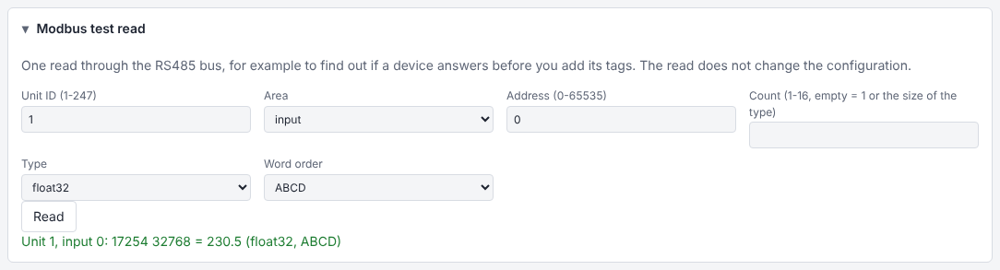

# Your first gateway: from a new board to data on the broker

In this tutorial, you set up one gateway on the bench. You flash the firmware, open the web UI, connect the gateway to an MQTT broker on your computer, add one Modbus device, and see its data in Sparkplug B. At the end, you know the main parts of the gateway and the usual sequence of work.

The tutorial takes approximately one hour. For each step, it tells you what you must see. For the reasons and the other options, it gives links to the other documents.

> **Warning: Do not use this document as verified data for the board.** The firmware has never run on the board (#1, #18). The Ethernet chip, the RS485 hardware mode, the LED and the buzzer are compile-only. The E2E runs the same steps in QEMU, and the images and the messages come from it.

## What you need

- The board Waveshare ESP32-S3-POE-ETH-8DI-8DO, with the RTC battery. Refer to [Fit the RTC battery](../how-to/fit-the-rtc-battery.md).
- A USB-C cable.
- An Ethernet cable, and a network with a DHCP server and access to the Internet (for the time server `pool.ntp.org`).
- A computer on the same network, with:
  - ESP-IDF v6.1 (refer to [`idf/README.md` §3.1](../../idf/README.md#31-esp-idf));
  - the Mosquitto broker and its clients (`mosquitto`, `mosquitto_sub`);
  - a clone of this repository.
- One Modbus RTU device with its register map, an RS485 cable, and a power supply for the device. A USB to RS485 adapter with a Modbus slave simulator on a second computer is also possible.

## 1. Flash the firmware

1. Connect the board to the computer with the USB-C cable.
2. Open a terminal with the ESP-IDF environment. Go to the folder `idf/` of the repository.
3. Build and flash the firmware, and open the console. Use the serial port of the board (for example `COM5` or `/dev/ttyACM0`):

   ```sh
   idf.py set-target esp32s3 build
   idf.py -p <port> flash monitor
   ```

4. Make sure that the console shows the boot of the gateway.

The gateway now runs the embedded example configuration: DHCP, the broker `192.168.1.10`, the group `Plant1`, the edge node `GW01` and one device `Meter1`. You change it in step 4.

Keep the monitor open for the next steps. To exit the monitor, push `Ctrl+]`.

## 2. Connect the network and find the address

1. Connect the Ethernet cable to the board.
2. On the console, find the line with the address of the gateway, for example `I (2345) net: IPv4 192.168.1.57 mask 255.255.255.0 gw 192.168.1.1`.
3. Find the line with the commissioning password, for example `web: no web password set; user 'admin', commissioning password 'k7Qm2xPa9TbE'`.
4. Find the line with the fingerprint of the certificate: `I (3456) web: HTTPS certificate SHA-256 fingerprint AB:CD:…`.

Each gateway has its own commissioning password and its own certificate. Only the console shows the password.

## 3. Open the web UI

1. In the browser, open `https://<address of step 2>/`.
2. The browser gives a warning about the certificate. Open the details of the certificate. Make sure that its SHA-256 fingerprint is the fingerprint on the console.
3. Accept the certificate.
4. Log in with the user `admin` and the commissioning password.
5. Make sure that the tab **Status** opens. The card **Gateway** shows the mode `normal`.

The broker `192.168.1.10` of the example is possibly not on your network. Then the card **Network and MQTT** shows MQTT `disconnected`, and the LED blinks amber.

## 4. Configure the broker and the web password

1. Start a broker on your computer. Accept the connections from the network:

   ```sh
   printf "listener 1883\nallow_anonymous true\n" > bench.conf
   mosquitto -c bench.conf -v
   ```

   This broker has no password and no TLS. Use it only on the bench.

2. In the web UI, click the tab **Configuration**.
3. In the card **MQTT**, set **Broker** to the address of your computer. Keep **Port** 1883.
4. In the card **Sparkplug**, keep **Group ID** `Plant1` and **Edge node ID** `GW01`, or type your own names.
5. In the card **Web interface**, type a new **Password** (8 to 63 printable ASCII characters). Record it.
6. Click **Validate** in the bar at the bottom of the window. Make sure that the bar shows "The configuration is valid."
7. Click **Save and restart**.
8. After the restart, log in with the user `admin` and the new password.

The new password is also the Wi-Fi password of the access point. The commissioning password is not valid now.

## 5. See the gateway on the broker

1. In a second terminal on your computer, subscribe to all Sparkplug topics:

   ```sh
   mosquitto_sub -h localhost -t 'spBv1.0/#' -F '%t %l bytes'
   ```

2. In the web UI, click the tab **Status**. In the card **Network and MQTT**, click **Rebirth**.
3. Make sure that `mosquitto_sub` shows a line like this one:

   ```text
   spBv1.0/Plant1/NBIRTH/GW01 1234 bytes
   ```

The payloads are Sparkplug B protobuf, not text. A Sparkplug host (for example Ignition with MQTT Engine, or UMH Core) decodes them. The NBIRTH gives all the metrics of the node, for example `Node Info/Firmware`, `DI/1` to `DI/8` and `DO/1` to `DO/8`.

If no NBIRTH comes, look at the LED. Magenta means that the gateway has no valid clock: it opens no MQTT session without a valid clock. Click **Set the time from the browser** in the card **Local I/O**, or let the gateway reach `pool.ntp.org`.

## 6. Connect the Modbus device

1. Connect the device to the RS485 terminals of the board. Refer to [Connect the RS485 bus](../how-to/connect-the-rs485-bus.md).
2. In the web UI, click the tab **Configuration**.
3. In the card **RS485**, set the baud rate, the parity and the stop bits of the device. Click **Save and restart** if you changed them.
4. In the card **Modbus test read**, type the unit ID of the device. Select an area, and type the address of a value that you know.
5. Click **Read**. Make sure that the result line shows the value.

   

If the result is `no answer from unit N (timeout)`, examine the unit ID, the RS485 settings and the wires A and B.

## 7. Add the device and one tag

1. In the card **Devices and tags**, find the device `Meter1` of the example. Change its **Unit ID** to the unit ID of your device.
2. Change the first tag to the value of step 6: the name, the area, the address, the type and the word order.
3. Delete the other tags with **x**.
4. Click **Validate**, then click **Save and restart**.

For all the fields, refer to [Add a Modbus device and its tags](../how-to/add-a-modbus-device.md).

## 8. See the data of the device

1. Click the tab **Status**. In the card **Modbus devices**, make sure that `Meter1` is online and that the tag has its value.

   

   The image shows the example configuration, with all the tags of `Meter1`.

2. Make sure that `mosquitto_sub` shows the DBIRTH of the device, and then a DDATA when the value changes:

   ```text
   spBv1.0/Plant1/DBIRTH/GW01/Meter1 456 bytes
   spBv1.0/Plant1/DDATA/GW01/Meter1 42 bytes
   ```

3. Make sure that the LED is green and continuous.

The gateway publishes a value only when it changes by more than the deadband of the tag (report by exception). Thus a value that does not change gives no DDATA.

## 9. Back up the configuration

1. In the web UI, click **Export**. Keep the file.

The file has no secrets: they show as `********`. Refer to [Change, back up and restore the configuration](../how-to/change-the-configuration.md).

## What you did

- You flashed the firmware over USB. The owner of the board can always do this again.
- You found the commissioning password and the fingerprint on the console, and opened the web UI over HTTPS.
- You set the broker, the Sparkplug names and the web password, and saved the configuration. Each save restarts the gateway.
- You read a register with the test read before you added the tag.
- You saw the NBIRTH, the DBIRTH and the DDATA on the broker.

## Next steps

- Install the gateway on site: [Set the first web password on site](../how-to/set-the-first-web-password.md) and [Get on the access point on a later visit](../how-to/get-on-the-access-point.md).
- Send the data to UMH Core: [Connect the gateway to UMH Core](../how-to/connect-to-umh-core.md).
- Write values from a host: [Write a value to a Modbus device or a digital output](../how-to/write-to-a-modbus-device.md).
- Update the firmware: [Update the firmware](../how-to/update-the-firmware.md).
- Use TLS and a password on the broker: refer to [`mqtt`](../reference/configuration.md#mqtt) and [`mqtt.tls`](../reference/configuration.md#mqtttls) in the configuration reference.
